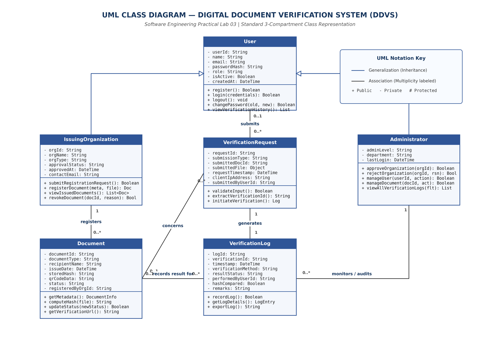

# EXPERIMENT 03: CLASS IDENTIFICATION, CLASSIFICATION AND UML CLASS DIAGRAM

## 1. Experiment Number
**Lab 03**

## 2. Experiment Title
**Class Identification, Classification, and UML Class Diagram for Digital Document Verification System (DDVS)**

---

## 3. Aim / Objective
To systematically identify the object-oriented classes from the Software Requirements Specification (SRS) of the Digital Document Verification System (DDVS), classify them into strong, weak, dependent, and specialized entities, specify their attributes and operations with appropriate data types and visibilities, establish structural associations with well-justified multiplicities, and construct a standardized three-compartment UML Class Diagram.

---

## 4. Theory / Introduction

### 4.1 Foundations of Object-Oriented Modeling
Object-Oriented Analysis and Design (OOAD) models a software system as a collection of cooperating objects, each encapsulating state (data) and behavior (operations).

- **Class**: A blueprint, prototype, or abstract specification that defines the shared structure, constraints, and behaviors of a category of objects.
- **Object**: A concrete instance of a class that exists at runtime, possessing an identity, specific attribute values (state), and the capability to execute operations.
- **Attributes**: Named data properties that describe the characteristics, qualities, or state of a class.
- **Methods (Operations)**: Dynamic procedural abstractions or functions that specify the services or behaviors an object provides to transform its state or interact with other objects.

### 4.2 Class Identification Techniques from System Requirements
In requirement-driven software engineering, classes are extracted from the SRS through three complementary analytical techniques:
1. **Grammatical Inspection (Noun-Phrase Extraction)**: Requirements statements are systematically scanned for nouns and noun phrases. Candidate nouns representing persistent entities, organizational roles, transactional artifacts, and audit trails are shortlisted (e.g., *User*, *Organization*, *Document*, *Hash*, *Log*), while verbs represent candidate operations (e.g., *register*, *verify*, *approve*).
2. **Class-Responsibility-Collaborator (CRC) Modeling**: Conceptual boundaries are verified by ensuring each proposed class exhibits high cohesion—a singular, focused responsibility with well-defined collaborators.
3. **Domain Entity Boundary Analysis**: Entities are segregated into core domain models, administrative controllers, transactional contexts, and audit ledgers.

---

## 5. Requirements and Tools
- **Operating Environment**: Cross-platform (Windows / Linux / macOS)
- **Modeling Tool**: diagrams.net (draw.io) Desktop & Web Editor (v24.7+)
- **Graphic Compilation**: Python 3.13, Matplotlib (Vector PDF & 300 DPI PNG backend)
- **Source Baseline**: IEEE-standard SRS for DDVS v1.0 (`Lab-01-SRS/SRS_Digital_Document_Verification_System_FINAL.pdf`)

---

## 6. Detailed Procedure

### Step 1: Candidate Class Extraction
From Sections 2.2, 2.3, 4.1–4.6, and Appendix B of the DDVS SRS, six primary conceptual entities were identified:
1. `User`
2. `IssuingOrganization`
3. `Administrator`
4. `Document`
5. `VerificationRequest`
6. `VerificationLog`

### Step 2: Entity Classification (Strong vs. Weak vs. Specialized)
A critical distinction in Software Engineering and Database Design is made between:
- **Strong (Independent) Entity/Class**: A class that possesses its own independent identity (a primary identifier) and whose lifecycle does not depend on the existence of any other entity in the system.
- **Weak / Dependent Entity/Class**: A class whose existence depends on an identifying owner entity and which lacks a complete primary identifier of its own without the owner's primary key.
- **Specialized Subclass (Inheritance)**: An entity that inherits attributes and operations from a generalized superclass while augmenting them with specialized state and behavior.

*Important Design Decision*: Neither `IssuingOrganization` nor `Administrator` is modeled as a weak class. In UML and object-oriented architecture, they represent **specializations (subclasses)** of `User` through **Generalization/Inheritance**. They inherit the global authentication and profile capabilities of `User` while encapsulating role-specific operations (e.g., document registration, organization approval). Meanwhile, `VerificationRequest` represents a **transactional boundary entity**, and `VerificationLog` represents an **audit trail entity** that maintains referential integrity to `Document` and `User`.

### Step 3: Attribute and Method Assignment
Attributes and operations were derived directly from functional requirements (FR-01 to FR-49), assigning formal visibilities (`+` Public, `-` Private, `#` Protected) and language-agnostic data types (`String`, `DateTime`, `Boolean`, `Integer`, `Object`).

### Step 4: Relationship and Multiplicity Determination
Associations, dependencies, and generalizations were synthesized to model real-world business constraints.

---

## 7. Design, Diagram, and Structural Specifications

### 7.1 Class Descriptions and Responsibilities

| Class Name | Type / Classification | Primary Responsibility | SRS Traceability |
| :--- | :--- | :--- | :--- |
| **`User`** | Strong Class (Superclass) | Encapsulates generic user identity, authentication, credential hashing, and base dashboard interactions. | Section 2.3, FR-01–FR-06, FR-10–FR-12 |
| **`IssuingOrganization`** | Subclass (Specialization of `User`) | Manages organizational profile, legal verification status, document issuance, metadata entry, and document revocation. | Section 2.3, FR-07–FR-08, FR-13–FR-21 |
| **`Administrator`** | Subclass (Specialization of `User`) | Performs governance: evaluates pending organizations, manages user accounts, revokes rogue records, and audits system logs. | Section 2.3, FR-09, FR-43–FR-49 |
| **`Document`** | Strong Class (Core Domain Entity) | Represents an issued digital credential with metadata, cryptographic SHA-256 hash, QR payload, and validity state. | Section 2.2, FR-13–FR-21, FR-22–FR-30 |
| **`VerificationRequest`** | Transactional Class (Boundary) | Encapsulates an incoming verification query submitted via Verification ID, QR code, or digital file upload. | Section 4.3, FR-22–FR-27, FR-30 |
| **`VerificationLog`** | Dependent Audit Class | Immutably persists the chronological record of every verification attempt, recording method, timestamp, and verdict. | Section 4.5, FR-36–FR-42, Section 6.1 |

---

### 7.2 Detailed Attributes and Methods Specification

```
+----------------------------------------------------------------------------------------------------+
|                                                User                                                |
+----------------------------------------------------------------------------------------------------+
| - userId: String                                                                                   |
| - name: String                                                                                     |
| - email: String                                                                                    |
| - passwordHash: String                                                                             |
| - role: String                                                                                     |
| - isActive: Boolean                                                                                |
| - createdAt: DateTime                                                                              |
+----------------------------------------------------------------------------------------------------+
| + register(): Boolean                                                                              |
| + login(credentials: Map): Boolean                                                                 |
| + logout(): void                                                                                   |
| + changePassword(oldPass: String, newPass: String): Boolean                                        |
| + viewVerificationHistory(): List<VerificationLog>                                                 |
+----------------------------------------------------------------------------------------------------+
                                                  ▲
                                                  |  (Generalization / Inheritance)
                        +-------------------------+-------------------------+
                        |                                                   |
+-----------------------------------------------+   +-----------------------------------------------+
|              IssuingOrganization              |   |                 Administrator                 |
+-----------------------------------------------+   +-----------------------------------------------+
| - orgId: String                               |   | - adminLevel: String                          |
| - orgName: String                             |   | - department: String                          |
| - orgType: String                             |   | - lastLogin: DateTime                         |
| - approvalStatus: String                      |   +-----------------------------------------------+
| - approvedAt: DateTime                        |   | + approveOrganization(orgId: String): Boolean |
| - contactEmail: String                        |   | + rejectOrganization(orgId: String): Boolean  |
+-----------------------------------------------+   | + manageUser(userId: String, act: String): Bool|
| + submitRegistrationRequest(): Boolean        |   | + manageDocument(docId: String, act): Boolean |
| + registerDocument(meta: Meta, f: File): Doc  |   | + viewAllVerificationLogs(flt: Filter): List  |
| + viewIssuedDocuments(): List<Document>       |   +-----------------------------------------------+
| + revokeDocument(docId: String, rsn): Boolean |
+-----------------------------------------------+
                        | 1
                        |
                        | registers
                        |
                        ▼ 0..*
+----------------------------------------------------------------------------------------------------+
|                                              Document                                              |
+----------------------------------------------------------------------------------------------------+
| - documentId: String                                                                               |
| - documentType: String                                                                             |
| - recipientName: String                                                                            |
| - issueDate: DateTime                                                                              |
| - storedHash: String                                                                               |
| - qrCodeData: String                                                                               |
| - status: String                                                                                   |
| - registeredByOrgId: String                                                                        |
+----------------------------------------------------------------------------------------------------+
| + getMetadata(): DocumentInfo                                                                      |
| + computeHash(file: Object): String                                                                |
| + updateStatus(newStatus: String): Boolean                                                         |
| + getVerificationUrl(): String                                                                     |
+----------------------------------------------------------------------------------------------------+
```

---

### 7.3 Complete Attributes and Operations Dictionary Table

| Class Name | Member Name | Member Type | Data Type / Return Type | Purpose and Responsibility |
| :--- | :--- | :--- | :--- | :--- |
| **`User`** | `userId` | Attribute | `String` | Unique surrogate key identifying the registered account. |
| | `name` | Attribute | `String` | Full legal name or representative name of the account holder. |
| | `email` | Attribute | `String` | Unique login email identifier (enforces RFC 5322 validation). |
| | `passwordHash`| Attribute | `String` | Secure one-way hashed credential (e.g., bcrypt/Argon2; FR-04). |
| | `role` | Attribute | `String` | Security role: Verifier, IssuingOrganization, or Administrator. |
| | `isActive` | Attribute | `Boolean` | Account operational status (True = active, False = disabled by Admin). |
| | `createdAt` | Attribute | `DateTime` | Timestamp of account registration. |
| | `register()` | Method | `Boolean` | Validates input format and persists new account record. |
| | `login()` | Method | `Boolean` | Compares credentials and issues authenticated session. |
| | `logout()` | Method | `void` | Invalidates active session token (FR-10). |
| | `changePassword()` | Method | `Boolean` | Verifies existing password and updates passwordHash (FR-12). |
| | `viewVerificationHistory()` | Method | `List<VerificationLog>` | Fetches verification history personal to this user (FR-39). |
| **`IssuingOrganization`** | `orgId` | Attribute | `String` | Unique business identifier for the issuing institution. |
| | `orgName` | Attribute | `String` | Official institutional/corporate name. |
| | `orgType` | Attribute | `String` | Category (e.g., University, Board, Corporation, Government). |
| | `approvalStatus` | Attribute | `String` | Governance status: `Pending`, `Approved`, or `Rejected` (FR-07). |
| | `approvedAt` | Attribute | `DateTime` | Timestamp of administrative review and approval. |
| | `contactEmail` | Attribute | `String` | Official administrative contact mailbox. |
| | `submitRegistrationRequest()` | Method | `Boolean` | Submits formal application for document-issuance privileges. |
| | `registerDocument()` | Method | `Document` | Validates payload, computes SHA-256 hash, generates ID/QR, and stores record (FR-13–FR-18). |
| | `viewIssuedDocuments()` | Method | `List<Document>` | Retrieves all credentials issued by this organization (FR-19). |
| | `revokeDocument()` | Method | `Boolean` | Marks an existing document record as `Invalid`/Revoked (FR-29). |
| **`Administrator`** | `adminLevel` | Attribute | `String` | Authorization hierarchy (e.g., SuperAdmin, Auditor). |
| | `department` | Attribute | `String` | Administrative organizational division. |
| | `lastLogin` | Attribute | `DateTime` | Timestamp of most recent privileged access session. |
| | `approveOrganization()` | Method | `Boolean` | Authorizes pending organization to issue credentials (FR-44). |
| | `rejectOrganization()` | Method | `Boolean` | Declines issuance application with rejection justification (FR-44). |
| | `manageUser()` | Method | `Boolean` | Activates, disables, or inspects user accounts (FR-45, FR-46). |
| | `manageDocument()` | Method | `Boolean` | Administratively revokes or invalidates document records (FR-47, FR-48). |
| | `viewAllVerificationLogs()` | Method | `List<VerificationLog>` | Retrieves system-wide verification logs with date/result filters (FR-40, FR-42). |
| **`Document`** | `documentId` | Attribute | `String` | Unique cryptographically randomized verification ID (FR-15). |
| | `documentType` | Attribute | `String` | Category (e.g., Degree Certificate, Mark Sheet, Identity Proof). |
| | `recipientName` | Attribute | `String` | Name of the candidate/individual to whom document was issued. |
| | `issueDate` | Attribute | `DateTime` | Official issuance date stated on the document. |
| | `storedHash` | Attribute | `String` | Cryptographic SHA-256 hash digest of original file (FR-16). |
| | `qrCodeData` | Attribute | `String` | Base64/URI encoded payload for rapid camera scanning (FR-17). |
| | `status` | Attribute | `String` | Lifecycle state: `Active`, `Invalid`, `Revoked` (FR-29). |
| | `registeredByOrgId`| Attribute | `String` | Foreign identifier referencing issuing organization. |
| | `getMetadata()` | Method | `DocumentInfo` | Returns public descriptive attributes without private hashes. |
| | `computeHash()` | Method | `String` | Generates standardized SHA-256 digest from byte stream. |
| | `updateStatus()` | Method | `Boolean` | Transitions document status flag upon revocation. |
| | `getVerificationUrl()` | Method | `String` | Constructs canonical direct web link for verification lookup. |
| **`VerificationRequest`** | `requestId` | Attribute | `String` | Transient session identifier for verification query. |
| | `submissionType` | Attribute | `String` | Input channel: `MANUAL_ID`, `QR_CODE`, or `FILE_UPLOAD`. |
| | `submittedDocId` | Attribute | `String` | Alphanumeric document identifier supplied by verifier. |
| | `submittedFile` | Attribute | `Object` | Optional uploaded binary stream/file handle. |
| | `requestTimestamp` | Attribute | `DateTime` | Exact system timestamp when request was received. |
| | `clientIpAddress` | Attribute | `String` | Network client IP address for rate-limiting and audit. |
| | `submittedByUserId` | Attribute | `String` | Optional userId (Null if performed by unauthenticated guest; FR-30). |
| | `validateInput()` | Method | `Boolean` | Sanitizes ID format, file MIME type, and size limits (FR-20, FR-21). |
| | `extractVerificationId()` | Method | `String` | Parses verification ID from direct text or QR payload. |
| | `initiateVerification()` | Method | `VerificationLog` | Orchestrates query matching, hash check, and log creation. |
| **`VerificationLog`** | `logId` | Attribute | `String` | Primary surrogate key for immutable audit ledger. |
| | `verificationId` | Attribute | `String` | Verification ID referenced during lookup. |
| | `timestamp` | Attribute | `DateTime` | Exact time verification transaction was finalized (FR-38). |
| | `verificationMethod` | Attribute | `String` | Verification vector: `ID_LOOKUP`, `QR_SCAN`, `FILE_HASH`. |
| | `resultStatus` | Attribute | `String` | Outcome: `Verified`, `Invalid`, `Not Found`, `Tampered` (FR-27–FR-29). |
| | `performedByUserId` | Attribute | `String` | User ID of verifier, or `'GUEST'` if unauthenticated. |
| | `hashCompared` | Attribute | `Boolean` | Flag indicating whether physical file hash was evaluated. |
| | `remarks` | Attribute | `String` | Diagnostic commentary (e.g., "Hash mismatch detected"). |
| | `recordLog()` | Method | `Boolean` | Persists log entry to relational storage (FR-37). |
| | `getLogDetails()` | Method | `LogEntry` | Formats log record for user or administrator view. |
| | `exportLog()` | Method | `String` | Serializes log entries into CSV/JSON format for compliance audit. |

---

### 7.4 Structural Relationships and Multiplicity Justifications

```
+----------------------------------------------------------------------------------------------------+
|                                    RELATIONSHIPS & MULTIPLICITIES                                  |
+----------------------------------------------------------------------------------------------------+
| Source Class           | Target Class           | UML Relationship | Multiplicity | Rationale      |
+------------------------+------------------------+------------------+--------------+----------------+
| IssuingOrganization   | User                   | Generalization   | N/A (Subtype)| Specialization |
| Administrator          | User                   | Generalization   | N/A (Subtype)| Specialization |
| IssuingOrganization   | Document               | Association      | 1 to 0..*    | 1 Org issues * |
| User (Verifier)        | VerificationRequest    | Association      | 0..1 to 0..* | Guests allowed |
| VerificationRequest    | Document               | Association      | 0..* to 0..1 | Query target   |
| VerificationRequest    | VerificationLog        | Association      | 1 to 1       | 1 Log per Req  |
| Document               | VerificationLog        | Association      | 0..1 to 0..* | Audit ledger   |
| Administrator          | VerificationLog        | Association      | 1 to 0..*    | Auditing       |
+----------------------------------------------------------------------------------------------------+
```

1. **`IssuingOrganization` ───► `User` (Generalization)**:
   - Model Choice: Generalization (Inheritance).
   - Justification: An issuing organization is an authenticated actor with credentials, email, and session states, extending `User` with legal organization attributes and document issuance rights.
2. **`Administrator` ───► `User` (Generalization)**:
   - Model Choice: Generalization (Inheritance).
   - Justification: Administrators share the foundational security properties of `User` while adding system-wide oversight capabilities.
3. **`IssuingOrganization` [1] ──── registers ──── [0..*] `Document`**:
   - Multiplicity: Exactly 1 organization registers 0 to many documents. A registered document must have originated from exactly one authorized issuing institution.
4. **`User` [0..1] ──── submits ──── [0..*] `VerificationRequest`**:
   - Multiplicity: Multiplicity on the `User` side is `0..1` because the SRS (FR-30, Appendix C TBD-03) explicitly supports unauthenticated guest verifications. A registered user may submit zero or multiple verification requests over time.
5. **`VerificationRequest` [0..*] ──── concerns ──── [0..1] `Document`**:
   - Multiplicity: A request queries at most one document record. If the submitted ID does not exist in the database, the target document is `0` (`Not Found`).
6. **`VerificationRequest` [1] ──── generates ──── [1] `VerificationLog`**:
   - Multiplicity: Every completed verification request generates exactly one immutable audit log entry (FR-37).
7. **`Document` [0..1] ──── records result for ──── [0..*] `VerificationLog`**:
   - Multiplicity: A document can be verified zero or hundreds of times. In cases where a non-existent document was queried, the log references `0` documents.
8. **`Administrator` [1] ──── monitors / audits ──── [0..*] `VerificationLog`**:
   - Multiplicity: Administrators query and review system-wide verification logs for auditing purposes.

---

## 8. UML Class Diagram Artifacts

The UML Class Diagram has been generated adhering strictly to OMG UML 2.5 standards:
- **Editable Source**: [`DDVS_Lab03_Class_Diagram.drawio`](file:///e:/Digital-Document-Verification-System/Lab-03-Class-Diagram/DDVS_Lab03_Class_Diagram.drawio)
- **Vector Document**: [`DDVS_Lab03_Class_Diagram.pdf`](file:///e:/Digital-Document-Verification-System/Lab-03-Class-Diagram/DDVS_Lab03_Class_Diagram.pdf)
- **High-Resolution Graphic**: [`DDVS_Lab03_Class_Diagram.png`](file:///e:/Digital-Document-Verification-System/Lab-03-Class-Diagram/DDVS_Lab03_Class_Diagram.png)



---

## 9. Explanation and Analysis

### 9.1 Evaluation of Inheritance vs. Composition for User Roles
In system architecture, modeling user roles can be approached through:
1. **Inheritance (Subtyping)**: Classifying `IssuingOrganization` and `Administrator` as derived classes of `User`.
2. **Role-Based Attribute Delegation**: Keeping a single `User` class with a `role` enum and optional profile objects.
*Academic Rationale*: In this UML conceptual class model, **Inheritance** is formally adopted because `IssuingOrganization` and `Administrator` possess distinct, non-overlapping sets of methods (`approveOrganization`, `registerDocument`) that cannot be invoked by ordinary verifiers. This enforces behavioral polymorphism and compile-time type safety at the domain level.

### 9.2 Decoupling of Verification Request and Verification Log
A common modeling mistake is conflating the incoming verification request with the recorded verification history.
- `VerificationRequest` is a **transient boundary object** that captures input arguments (raw text, file stream, IP address) and orchestrates the verification sequence.
- `VerificationLog` is a **persistent entity object** that serves as an append-only legal audit trail.
Decoupling them ensures that even if an invalid file format crashes the parser, a log entry capturing the failed attempt can still be recorded independently.

### 9.3 Guest Verification Support (`User` Multiplicity `0..1`)
As highlighted in SRS FR-30, external employers or credential checkers must be able to verify certificates without mandatory registration. By modeling the association from `User` to `VerificationRequest` with multiplicity `0..1`, the system elegantly supports both logged-in verifiers (whose history is linked to their profile; FR-39) and anonymous public verifiers.

---

## 10. Result and Conclusion

### 10.1 Result
All six required classes for the Digital Document Verification System were identified, classified, and fully specified with standardized attributes, operations, visibilities, and multiplicities. The complete UML Class Diagram was created and verified in diagrams.net XML (`.drawio`), vector PDF, and high-resolution PNG formats.

### 10.2 Conclusion
The formulated class structure establishes a robust, highly cohesive, and loosely coupled structural blueprint for DDVS. It rigorously enforces requirements traceability to the SRS, provides clear separation between user governance, document issuance, verification logic, and compliance logging, and forms the definitive architectural foundation for subsequent behavioral and dynamic modeling in Labs 04 through 08.
