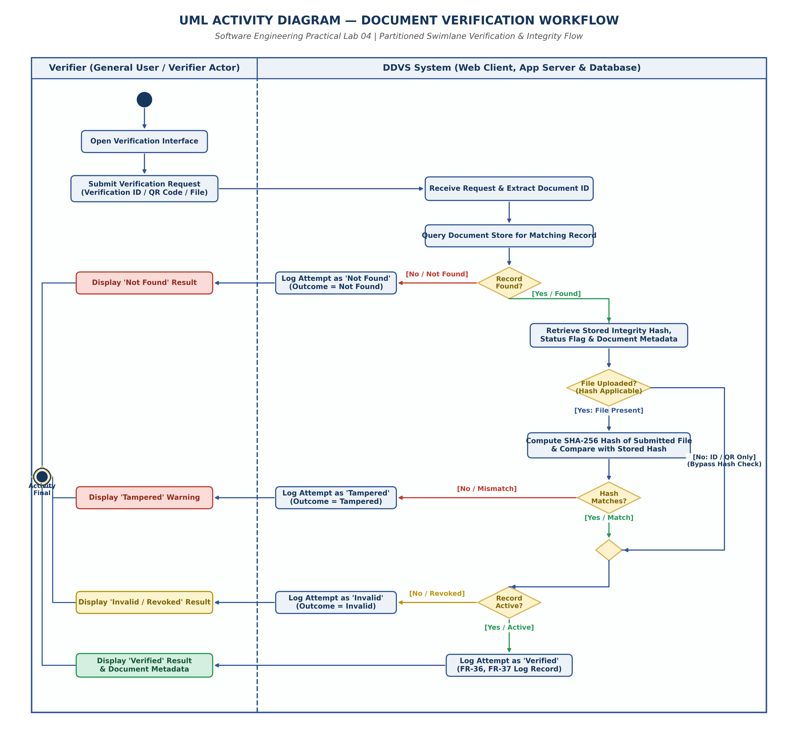

# EXPERIMENT 04: UML ACTIVITY DIAGRAM

## 1. Experiment Number
**Lab 04**

## 2. Experiment Title
**UML Activity Diagram for Document Verification and Integrity Checking Workflow in DDVS**

---

## 3. Aim / Objective
To model the dynamic, step-by-step procedural workflow of document verification in the Digital Document Verification System (DDVS) using a partitioned UML Activity Diagram with swimlanes, accurately capturing multi-channel input handling (Verification ID, QR code, and digital file upload), branch decision logic (record lookup, cryptographic hash matching, and record revocation state), and comprehensive audit logging.

---

## 4. Theory / Introduction

### 4.1 Foundations of UML Activity Diagrams
A UML Activity Diagram is a behavioral diagram that models the operational workflow, control logic, and sequential or concurrent computational steps within a system. While Use Case diagrams capture *what* the system does from an external actor's perspective, Activity Diagrams capture *how* business logic executes dynamically over time.

### 4.2 Key Notational Elements
1. **Initial Node (Start)**: Represented by a solid filled black circle (`●`). Marks the entry point of control flow into the activity.
2. **Action Node**: Represented by a rounded rectangle. Denotes an atomic, non-interruptible step in the execution of an activity (e.g., *Query Document Store*, *Compute SHA-256 Hash*).
3. **Control Flow (Edge)**: Represented by a solid directed arrow (`──►`). Directs the transfer of execution tokens from one action to the subsequent node.
4. **Decision Node**: Represented by a diamond (`◇`) with one incoming edge and two or more outgoing guarded edges. Evaluates dynamic boolean conditions at runtime to select exactly one alternate path.
5. **Merge Node**: Represented by a diamond (`◇`) with multiple incoming edges and one outgoing edge. Re-converges alternate execution branches without synchronization.
6. **Guard Condition**: Represented by square brackets `[condition]` placed adjacent to decision output edges. Specifies the prerequisite state that must be true for control to follow that edge.
7. **Activity Final Node**: Represented by a bullseye circle with a solid inner circle (`⦿`). Terminates all active control flows within the activity.
8. **Swimlanes (Partitions)**: Vertical or horizontal columns that divide action nodes based on organizational responsibility or architectural tiers (e.g., *Verifier* vs. *DDVS System*).

---

## 5. Requirements and Tools
- **Operating Environment**: Cross-platform (Windows / Linux / macOS)
- **Modeling Tool**: diagrams.net (draw.io) Desktop & Web Editor (v24.7+)
- **Graphic Compilation**: Python 3.13, Matplotlib (Vector PDF & 300 DPI PNG backend)
- **Source Baseline**: IEEE-standard SRS for DDVS v1.0 (Sections 4.3, 4.4, 4.5, and Appendix B)

---

## 6. Detailed Procedure

### Step 1: Workflow Boundary and Swimlane Definition
The verification workflow was partitioned across two distinct operational swimlanes:
1. **Verifier Swimlane**: Encapsulates user-facing client interactions (submitting queries, receiving feedback, and reviewing credential metadata).
2. **DDVS System Swimlane**: Encapsulates server-side execution, database query execution, cryptographic hash evaluation, and audit logging.

### Step 2: Input Handling and Document Identification
The workflow accommodates all three verification vectors established in SRS Section 4.3:
- Manual entry of an alphanumeric Verification ID (FR-22).
- Scanning of a printed or digital QR Code encoding the Verification ID (FR-23).
- Uploading an electronic document file (PDF; FR-24).

### Step 3: Branching and Decision Logic Synthesis
Four sequential evaluation milestones were integrated into the control flow:
1. **Milestone 1 — Record Lookup**: Does the submitted ID correspond to an existing record in the Document Store?
2. **Milestone 2 — Hash Applicability**: Was a physical digital file submitted? If yes, evaluate the cryptographic hash; if only an ID or QR code was submitted, bypass the file hash check without forcing an unneeded upload.
3. **Milestone 3 — Cryptographic Integrity**: Does the computed SHA-256 hash match the immutable hash stored at issuance?
4. **Milestone 4 — Operational Status**: Is the document status flag `Active` (valid) or has it been marked `Invalid` / `Revoked` by an administrator or issuing organization?

### Step 4: Audit Logging Integration
In strict compliance with SRS FR-36, FR-37, and FR-38, an audit logging step is executed across **every single outcome branch** (`Verified`, `Tampered`, `Invalid`, `Not Found`) prior to presenting the verdict to the user.

---

## 7. Design, Diagram, and Workflow Specifications

### 7.1 Verification Decision Table

The complete decision logic governing the activity flow is formalized in the decision table below:

| Rule # | Record Found in DB? | File Uploaded? | Hash Matches Stored Hash? | Status Flag in DB | System Action / Log Outcome | Verifier Screen Verdict | SRS Traceability |
| :---: | :---: | :---: | :---: | :---: | :---: | :---: | :---: |
| **R1** | **False (No)** | N/A | N/A | N/A | Log attempt as `Not Found` | **Display "Not Found"** | FR-25, FR-37 |
| **R2** | **True (Yes)** | **True (Yes)** | **False (Mismatch)** | Any | Log attempt as `Tampered` | **Display "Tampered" Warning** | FR-28, FR-34, FR-36 |
| **R3** | **True (Yes)** | **True (Yes)** | **True (Match)** | **Inactive / Revoked** | Log attempt as `Invalid` | **Display "Invalid / Revoked"** | FR-29, FR-37 |
| **R4** | **True (Yes)** | **True (Yes)** | **True (Match)** | **Active** | Log attempt as `Verified` | **Display "Verified" + Metadata** | FR-27, FR-37 |
| **R5** | **True (Yes)** | **False (No)** | Bypass (N/A) | **Inactive / Revoked** | Log attempt as `Invalid` | **Display "Invalid / Revoked"** | FR-26, FR-29 |
| **R6** | **True (Yes)** | **False (No)** | Bypass (N/A) | **Active** | Log attempt as `Verified` | **Display "Verified" + Metadata** | FR-26, FR-27 |

---

### 7.2 Textual Control Flow Diagram

```
[Verifier Swimlane]                                  [DDVS System Swimlane]
  (● Initial Node)
        │
        ▼
[Open Verification Interface]
        │
        ▼
[Submit Request: ID/QR/File] ──────────────────────► [Receive Request & Extract ID]
                                                               │
                                                               ▼
                                                     [Query Document Store]
                                                               │
                                                               ▼
                                                    ◇ Record Found?
                                                    ├── [No] ──────────────────────────► [Log: "Not Found"]
                                                    │                                          │
                                                    └── [Yes]                                  ▼
                                                          │                           [Display "Not Found"]
                                                          ▼                                    │
                                                    [Retrieve Metadata & Hash]                 │
                                                          │                                    │
                                                          ▼                                    │
                                                    ◇ File Uploaded?                           │
                                                    ├── [Yes: File Uploaded]                   │
                                                    │         │                                │
                                                    │         ▼                                │
                                                    │   [Compute SHA-256 Hash]                 │
                                                    │         │                                │
                                                    │         ▼                                │
                                                    │   ◇ Hash Matches?                        │
                                                    │   ├── [No] ──────────────────────► [Log: "Tampered"]
                                                    │   │                                      │
                                                    │   └── [Yes]                              ▼
                                                    │         │                       [Display "Tampered"]
                                                    └── [No: ID/QR Only]                       │
                                                              │ (Bypass Hash)                  │
                                                              ▼                                │
                                                    ◇ Merge Node                               │
                                                              │                                │
                                                              ▼                                │
                                                    ◇ Record Active?                           │
                                                    ├── [No / Revoked] ────────────────► [Log: "Invalid"]
                                                    │                                          │
                                                    └── [Yes / Active]                         ▼
                                                              │                       [Display "Invalid"]
                                                              ▼                                │
                                                    [Log: "Verified"]                          │
                                                              │                                │
                                                              ▼                                │
                                                    [Display "Verified"]                       │
                                                              │                                │
                                                              ▼                                │
                                                    ◇ Final Merge Node ◄───────────────────────┘
                                                              │
                                                              ▼
                                                      (⦿ Activity Final)
```

---

## 8. UML Activity Diagram Artifacts

The UML Activity Diagram has been compiled in three standard formats:
- **Editable Source**: [`DDVS_Lab04_Activity_Diagram.drawio`](file:///e:/Digital-Document-Verification-System/Lab-04-Activity-Diagram/DDVS_Lab04_Activity_Diagram.drawio)
- **Vector Document**: [`DDVS_Lab04_Activity_Diagram.pdf`](file:///e:/Digital-Document-Verification-System/Lab-04-Activity-Diagram/DDVS_Lab04_Activity_Diagram.pdf)
- **High-Resolution Graphic**: [`DDVS_Lab04_Activity_Diagram.png`](file:///e:/Digital-Document-Verification-System/Lab-04-Activity-Diagram/DDVS_Lab04_Activity_Diagram.png)



---

## 9. Explanation and Analysis

### 9.1 Decoupled Hash Applicability Branch
A frequent flaw in naive verification workflows is requiring a file upload for all requests. The SRS (FR-22, FR-23) explicitly permits verifiers to look up credentials using only a printed verification ID or an encoded QR code.
- By incorporating **Decision Node 2 (`File Uploaded?`)**, the workflow intelligently detects if a document byte stream is available.
- If a file is uploaded, cryptographic integrity checking is enforced (`Compute SHA-256` -> `Compare`).
- If only an ID or QR code is provided, control flow bypasses the hash computation and transitions directly to status validation, preventing runtime exceptions and honoring the specification.

### 9.2 Mandatory Audit Logging on Terminal Paths
Under security auditing principles (SRS Section 4.5 and Section 5.3), failed and suspicious verification attempts are as critical as successful verifications.
- If a tampered document is detected (Rule R2), logging the event with the client IP address and timestamp creates an evidentiary record against credential fraud.
- If an invalid/revoked document is presented (Rule R3/R5), logging flags potential attempts to use expired qualifications.
- By placing dedicated logging actions before every user-facing feedback action, DDVS ensures no verification transaction completes unrecorded.

### 9.3 Soft-Deletion vs. Hard-Deletion Support
In accordance with SRS Section 6.2 (*Data Retention*), revoked or disabled credentials are never purged from physical storage. If a hard-deletion were executed, revoked certificates would trigger the `Not Found` outcome. Retaining revoked records with an `isActive = False` status flag allows the system to accurately deliver the `Invalid` outcome, proving the credential once existed but is no longer valid.

---

## 10. Result and Conclusion

### 10.1 Result
The end-to-end verification activity workflow of the Digital Document Verification System was analyzed and formally represented using a partitioned UML Activity Diagram with swimlanes. All decision branches, cryptographic comparisons, error states, and logging triggers were verified and exported in `.drawio`, `.pdf`, and `.png` formats.

### 10.2 Conclusion
The activity diagram provides an unambiguous procedural specification for developers implementing the verification engine. By modeling explicit guard conditions, bypass routes for lightweight lookups, and guaranteed audit trails, the design ensures system security, operational transparency, and exact compliance with the SRS.

