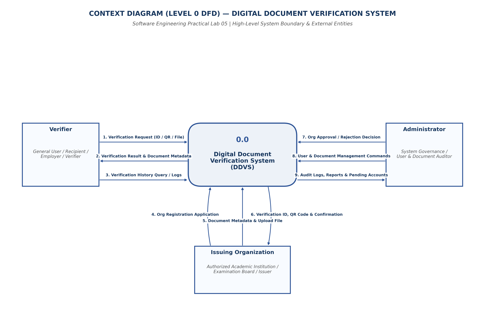
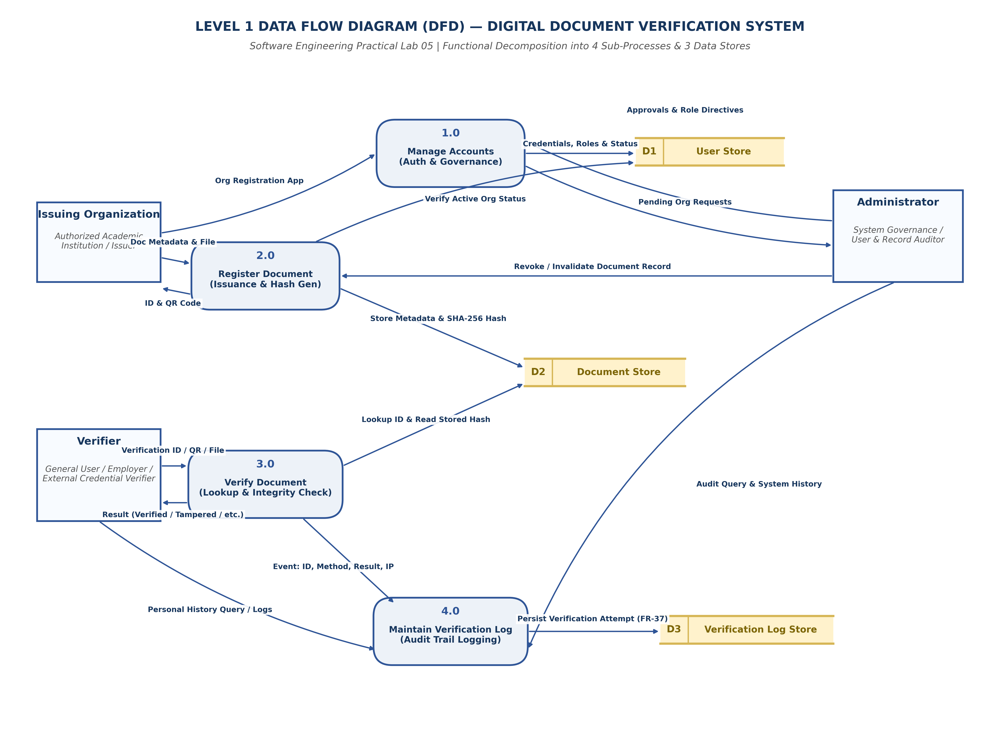

# EXPERIMENT 05: DATA FLOW DIAGRAM (DFD)

## 1. Experiment Number
**Lab 05**

## 2. Experiment Title
**Data Flow Diagram (DFD) Modeling: Context Diagram (Level 0) and Decomposed Level 1 DFD for DDVS**

---

## Project and Team Information
- **Project Title:** Digital Document Verification System (DDVS)
- **Team Size:** 4 Members
- **Project Team Members:**
  1. Divya Kumari
  2. Divyanshi Jaiswal
  3. Divyanshi Khemani
  4. Divyanshu Gupta
- **Course / Subject:** B.Tech Computer Science & Engineering — Software Engineering Laboratory
- **Authoritative Baseline:** IEEE-Standard SRS for DDVS v1.0 (August 31, 2026)

---

## Deliverables Summary and Moodle Submission Files
- **Moodle Submission Document (DOCX):** [`DDVS_Lab05_Data_Flow_Diagram.docx`](DOCX/DDVS_Lab05_Data_Flow_Diagram.docx) *(Located in `DOCX/` subfolder with embedded diagrams)*
- **Editable Draw.io Source Models:**
  - Context Diagram: [`DDVS_Lab05_Context_Diagram.drawio`](DDVS_Lab05_Context_Diagram.drawio)
  - Level 1 DFD: [`DDVS_Lab05_Level1_DFD.drawio`](DDVS_Lab05_Level1_DFD.drawio)
- **Vector PDF Exports:**
  - Context Diagram: [`DDVS_Lab05_Context_Diagram.pdf`](DDVS_Lab05_Context_Diagram.pdf)
  - Level 1 DFD: [`DDVS_Lab05_Level1_DFD.pdf`](DDVS_Lab05_Level1_DFD.pdf)
- **High-Resolution PNG Previews:**
  - Context Diagram: [`DDVS_Lab05_Context_Diagram.png`](DDVS_Lab05_Context_Diagram.png)
  - Level 1 DFD: [`DDVS_Lab05_Level1_DFD.png`](DDVS_Lab05_Level1_DFD.png)

---

## 3. Aim / Objective
To model the functional decomposition and information transformation within the Digital Document Verification System (DDVS) by designing:
1. A **Context Diagram (Level 0 DFD)** defining external entity boundaries and high-level data exchanges.
2. A decomposed **Level 1 DFD** isolating the four core SRS business processes (`Manage Accounts`, `Register Document`, `Verify Document`, and `Maintain Verification Log`) and three persistent data stores (`User Store`, `Document Store`, `Verification Log Store`).
3. A formal **Balancing Matrix**, **Process Specifications (P-Specs)**, and **Data Dictionary** verifying conservation of data flow across hierarchical levels.

---

## 4. Theory / Introduction

### 4.1 Foundations of Data Flow Modeling
A Data Flow Diagram (DFD) is a structured analysis tool that models how data flows through an information system, where it originates, how it is transformed by automated processes, where it is stored at rest, and where it is ultimately consumed.

Unlike UML diagrams that emphasize object-oriented hierarchies (Class Diagram) or temporal activation (Sequence Diagram), DFDs provide a **functional, data-centric perspective** of system computation.

### 4.2 The Four Fundamental DFD Notational Elements
The Yourdon & DeMarco / Gane & Sarson hybrid convention is adopted:
1. **External Entity (Source / Sink)**: Represented by a rectangle. An external person, organization, or external system that lies outside the boundary of DDVS and communicates by supplying inputs or receiving outputs (e.g., *Verifier*, *Issuing Organization*, *Administrator*). Entities **never** read or write directly to data stores.
2. **Process**: Represented by a circle or rounded rectangle with a unique decimal identification number and an active verb-noun phrase. Represents a computational transformation of incoming data packets into outgoing information (e.g., `1.0 Manage Accounts`, `3.0 Verify Document`).
3. **Data Flow**: Represented by a directed curved or straight line with an arrowhead (`──►`) and a noun label. Signifies the transmission of data packets between entities and processes, between processes, or between processes and data stores.
4. **Data Store**: Represented by an open-ended rectangle or parallel horizontal lines with a store identifier (`D1`, `D2`, `D3`). Represents data at rest within persistent storage (relational database tables).

### 4.3 Logical vs. Physical DFDs
- **Logical DFD**: Focuses strictly on business information flows and transformations, independent of underlying technology, programming languages, database management systems, or storage hardware.
- **Physical DFD**: Captures technical implementation decisions (e.g., SQL tables, REST endpoints, JSON tokens, cloud file buckets).
*Design Baseline*: In accordance with the SRS (Section 2.1, Appendix C), this experiment establishes the **Logical DFD** to preserve architectural independence.

---

## 5. Requirements and Tools
- **Operating Environment**: Cross-platform (Windows / Linux / macOS)
- **Modeling Tool**: diagrams.net (draw.io) Desktop & Web Editor (v24.7+)
- **Graphic Compilation**: Python 3.13, Matplotlib (Vector PDF & 300 DPI PNG backend)
- **Source Baseline**: IEEE-standard SRS for DDVS v1.0 (Section 2.2, Section 4.1–4.6, Appendix B)

---

## 6. Detailed Procedure

### Step 1: Boundary Definition and Context Diagram (Level 0) Construction
The complete system is abstracted as a single top-level process: `0.0 Digital Document Verification System (DDVS)`. External entities interacting across the system boundary were mapped:
- **`Verifier`**: Submits verification queries and receives authenticity verdicts and personal verification logs.
- **`Issuing Organization`**: Submits account registration requests, enters document metadata, uploads document files, and receives verification credentials (ID and QR code).
- **`Administrator`**: Issues approval/rejection decisions, issues user and document management commands, and audits system-wide logs.

### Step 2: Functional Decomposition into Level 1 Processes
Following the primary functional features specified in SRS Section 4 and Appendix B, Process `0.0` was decomposed into four major processes:
1. `1.0 Manage Accounts` (SRS Section 4.1, 4.6)
2. `2.0 Register Document` (SRS Section 4.2)
3. `3.0 Verify Document` (SRS Section 4.3, 4.4)
4. `4.0 Maintain Verification Log` (SRS Section 4.5)

### Step 3: Data Store Identification
Three logical data repositories were introduced from SRS Section 6.1:
- `D1 User Store`: Persists user accounts, credentials, organizational roles, and active flags.
- `D2 Document Store`: Persists document metadata, SHA-256 hashes, QR codes, and lifecycle status.
- `D3 Verification Log Store`: Immutably records every verification event.

### Step 4: Verification of Syntactic DFD Rules
Strict DFD syntactic rules were validated:
- No entity is directly linked to another entity (communication must pass through a process).
- No entity reads from or writes to a data store directly (all database I/O is mediated by a process).
- No data moves directly from one data store to another without process mediation.
- No "black holes" (processes with only inputs and no outputs) or "miracles" (processes with only outputs and no inputs).

---

## 7. Diagrams and Structural Specifications

### 7.1 Context Diagram (Level 0 DFD) Artifacts
- **Editable Source**: [`DDVS_Lab05_Context_Diagram.drawio`](file:///e:/Digital-Document-Verification-System/Lab-05-Data-Flow-Diagram/DDVS_Lab05_Context_Diagram.drawio)
- **Vector Document**: [`DDVS_Lab05_Context_Diagram.pdf`](file:///e:/Digital-Document-Verification-System/Lab-05-Data-Flow-Diagram/DDVS_Lab05_Context_Diagram.pdf)
- **High-Resolution Graphic**: [`DDVS_Lab05_Context_Diagram.png`](file:///e:/Digital-Document-Verification-System/Lab-05-Data-Flow-Diagram/DDVS_Lab05_Context_Diagram.png)

---

### 7.2 Level 1 DFD Artifacts
- **Editable Source**: [`DDVS_Lab05_Level1_DFD.drawio`](file:///e:/Digital-Document-Verification-System/Lab-05-Data-Flow-Diagram/DDVS_Lab05_Level1_DFD.drawio)
- **Vector Document**: [`DDVS_Lab05_Level1_DFD.pdf`](file:///e:/Digital-Document-Verification-System/Lab-05-Data-Flow-Diagram/DDVS_Lab05_Level1_DFD.pdf)
- **High-Resolution Graphic**: [`DDVS_Lab05_Level1_DFD.png`](file:///e:/Digital-Document-Verification-System/Lab-05-Data-Flow-Diagram/DDVS_Lab05_Level1_DFD.png)

---

## 8. Process Specifications and Data Dictionary

### 8.1 Process Specifications (P-Specs)

| Process ID | Process Name | Source Entities / Stores | Target Entities / Stores | Transformation Logic Summary |
| :---: | :---: | :---: | :---: | :---: |
| **`1.0`** | **Manage Accounts** | `Issuing Organization`, `Administrator`, `D1 User Store` | `D1 User Store`, `Administrator`, `Issuing Organization` | Validates registration data, hashes passwords, queues organization accounts in `Pending` state, processes Admin approval/rejection decisions, and updates account activation flags (FR-01–FR-12, FR-43–FR-46). |
| **`2.0`** | **Register Document** | `Issuing Organization`, `D1 User Store`, `Administrator` | `D2 Document Store`, `Issuing Organization` | Validates that issuer is active in `D1`, accepts metadata and file upload, computes SHA-256 cryptographic hash, generates unique verification ID and QR code, and writes record to `D2`. Also accepts Admin revocation commands (FR-13–FR-21, FR-47–FR-48). |
| **`3.0`** | **Verify Document** | `Verifier`, `D2 Document Store` | `Verifier`, `4.0 Maintain Verification Log` | Extracts Verification ID from text, QR, or file. Queries `D2`. If found and file provided, compares computed hash against stored hash. Evaluates active status flag. Produces verdict (`Verified`, `Invalid`, `Tampered`, `Not Found`) and passes event token to Process `4.0` (FR-22–FR-30, FR-33–FR-35). |
| **`4.0`** | **Maintain Verification Log**| `3.0 Verify Document`, `Verifier`, `Administrator`, `D3 Log Store` | `D3 Log Store`, `Verifier`, `Administrator` | Receives verification event metadata from Process `3.0` and appends an immutable audit entry to `D3`. Retrieves personal history for Verifiers and system-wide filtered audit reports for Administrators (FR-36–FR-42). |

---

### 8.2 Data Store Descriptions

| Store ID | Store Name | Associated Relational Table | Key Data Fields Persisted | Retention & Integrity Constraints |
| :---: | :---: | :---: | :---: | :---: |
| **`D1`** | **User Store** | `users`, `issuing_organizations` | `userId`, `name`, `email`, `passwordHash`, `role`, `orgType`, `approvalStatus`, `isActive`, `createdAt` | Enforces email uniqueness. Passwords stored only as secure cryptographic hashes. Soft-deletion via `isActive` flag (FR-04, FR-46). |
| **`D2`** | **Document Store** | `documents` | `documentId`, `documentType`, `recipientName`, `issueDate`, `storedHash`, `qrCodeData`, `status`, `registeredByOrgId` | `documentId` is unique primary key. Foreign key references `D1.orgId`. Revoked documents retained permanently with `status = 'Revoked'` (FR-15, FR-29, Section 6.2). |
| **`D3`** | **Verification Log Store**| `verification_logs` | `logId`, `verificationId`, `timestamp`, `verificationMethod`, `resultStatus`, `performedByUserId`, `clientIp`, `hashCompared` | Append-only ledger. Foreign key to `D2.documentId` (nullable when `Not Found`). Retained for a minimum of 1 year for compliance audits (FR-38, Section 6.1, 6.2). |

---

## 9. Balancing and Validation

### 9.1 The DFD Balancing Principle
In Structured Analysis, **Balancing** dictates that all input and output data flows crossing the external boundary in a parent diagram (Level 0) must be completely preserved and accounted for in the decomposed child diagram (Level 1). No external flow may disappear, and no new unlinked external flow may appear.

### 9.2 Formal DFD Balancing Matrix

| External Entity | Net Flow in Context Diagram (Level 0) | Direction | Corresponding Sub-Process in Level 1 DFD | Preserved & Balanced? |
| :---: | :---: | :---: | :---: | :---: |
| **Verifier** | `Verification Request (ID / QR / File)` | Entity ──► System | Received by `3.0 Verify Document` | **YES** (Balanced) |
| **Verifier** | `Verification Result & Metadata` | System ──► Entity | Dispatched by `3.0 Verify Document` | **YES** (Balanced) |
| **Verifier** | `Personal Verification History Query / Logs` | Bidirectional | Handled by `4.0 Maintain Verification Log` | **YES** (Balanced) |
| **Issuing Organization** | `Account Registration Request` | Entity ──► System | Received by `1.0 Manage Accounts` | **YES** (Balanced) |
| **Issuing Organization** | `Document Metadata & File` | Entity ──► System | Received by `2.0 Register Document` | **YES** (Balanced) |
| **Issuing Organization** | `Verification ID, QR Code & Confirmation` | System ──► Entity | Dispatched by `2.0 Register Document` | **YES** (Balanced) |
| **Administrator** | `Org Approval / Rejection Decisions` | Entity ──► System | Received by `1.0 Manage Accounts` | **YES** (Balanced) |
| **Administrator** | `User & Document Management Commands` | Entity ──► System | Split to `1.0 Manage Accounts` & `2.0 Register Document` | **YES** (Balanced) |
| **Administrator** | `Audit Logs, Reports & Pending Accounts` | System ──► Entity | Dispatched by `1.0 Manage Accounts` & `4.0 Maintain Log` | **YES** (Balanced) |

*Validation Verdict*: All external boundary flows are strictly conserved between Level 0 and Level 1.

---

## 10. Result and Conclusion

### 10.1 Result
The data flow architecture of DDVS was successfully developed at two levels of abstraction:
1. A Context Diagram (Level 0 DFD) encapsulating the system boundary and external entities.
2. A Level 1 DFD decomposing the core system into 4 distinct functional processes and 3 persistent data stores.
Both diagrams were compiled and verified in editable `.drawio`, vector `.pdf`, and high-resolution `.png` formats alongside complete Process Specifications and a DFD Balancing Matrix.

### 10.2 Conclusion
The DFD model rigorously demonstrates the separation of concerns inside DDVS. By isolating account management, document registration, verification processing, and compliance logging into discrete functional units mediated by structured data stores, the design achieves high functional cohesion, eliminates unauthorized entity-to-store data coupling, and provides an actionable blueprint for implementation.

