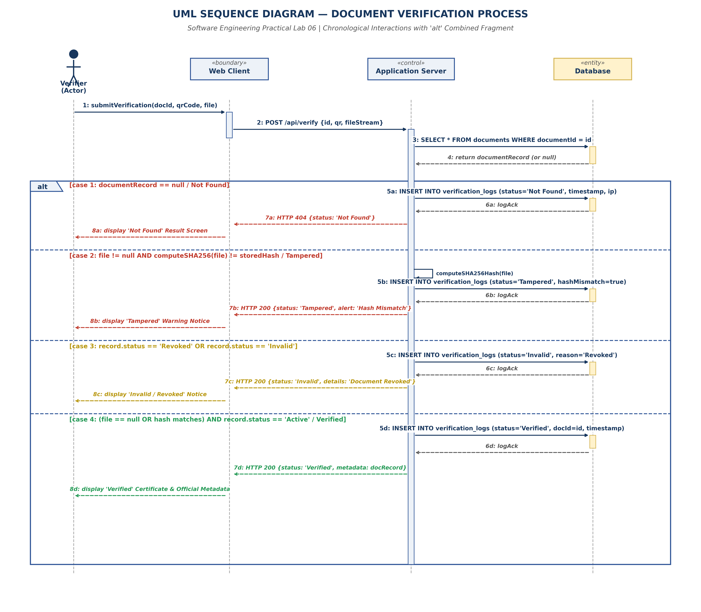

# EXPERIMENT 06: UML SEQUENCE DIAGRAM

## 1. Experiment Number
**Lab 06**

## 2. Experiment Title
**UML Sequence Diagram for Document Verification and Integrity Checking Interactions in DDVS**

---

## Project and Team Information
- **Project Title:** Digital Document Verification System (DDVS)
- **Team Size:** 4 Members
- **Project Team Members:**
  1. Divya Kumari
  2. Divyanshi Jaiswal
  3. Divyanshi Khemani
  4. Divyanshu Gupta
- **Course / Subject:** B.Tech Computer Science & Engineering — Software Engineering Laboratory
- **Authoritative Baseline:** IEEE-Standard SRS for DDVS v1.0 (August 31, 2026)

---

## Deliverables Summary and Moodle Submission Files
- **Moodle Submission Document (DOCX):** [`DDVS_Lab06_Sequence_Diagram.docx`](DOCX/DDVS_Lab06_Sequence_Diagram.docx) *(Located in `DOCX/` subfolder with embedded diagram)*
- **Editable Draw.io Diagram:** [`DDVS_Lab06_Sequence_Diagram.drawio`](DDVS_Lab06_Sequence_Diagram.drawio)
- **Vector PDF Export:** [`DDVS_Lab06_Sequence_Diagram.pdf`](DDVS_Lab06_Sequence_Diagram.pdf)
- **High-Resolution PNG Preview:** [`DDVS_Lab06_Sequence_Diagram.png`](DDVS_Lab06_Sequence_Diagram.png)

---

## 3. Aim / Objective
To model the dynamic, chronological message exchanges and architectural interactions among DDVS participants (`Verifier`, `Web Client`, `Application Server`, and `Database`) during the document verification workflow, incorporating UML `alt` combined fragments to capture all mutually exclusive outcome branches (`Verified`, `Tampered`, `Invalid`, and `Not Found`) alongside guaranteed audit trail persistence.

---

## 4. Theory / Introduction

### 4.1 Foundations of UML Sequence Diagrams
A UML Sequence Diagram is an interaction diagram that models how groups of software objects or architectural tiers collaborate to execute a use case over time. It places primary emphasis on the **temporal ordering of messages** transmitted between participating classifiers.

### 4.2 Key Notational Elements
1. **Lifeline**: Represented by a vertical dashed line extending downward from a classifier box. Signifies the existence and duration of a participant over the execution timeline.
2. **Actor**: Represented by a stick figure symbol. Denotes a human user or external system initiating interaction (e.g., `Verifier`).
3. **Classifier Roles (BCE Pattern)**:
   - **Boundary (`«boundary»`)**: Interfaces with external actors (e.g., `Web Client`).
   - **Control (`«control»`)**: Mediates transactions, encapsulates business rules, and coordinates execution (e.g., `Application Server`).
   - **Entity (`«entity»`)**: Persists domain data and maintains records (e.g., `Database`).
4. **Activation Bar (Focus of Control)**: A thin vertical rectangle overlaid on a lifeline, indicating the period during which an object is actively executing an operation or waiting for a synchronous return.
5. **Synchronous Call**: Represented by a solid line with a solid filled arrowhead (`──►`). The caller blocks and waits for computation to complete.
6. **Return Message**: Represented by a dashed line with an open stick arrowhead (`< - - -`). Returns data or control to the invoking caller.
7. **Combined Fragment (`alt`)**: A UML 2.x interaction frame labeled `alt` (alternative) used to model mutually exclusive conditional execution branches (equivalent to an `if-else if-else` control structure). Operands are separated by dashed horizontal divider lines with explicit guard conditions `[condition]`.

---

## 5. Requirements and Tools
- **Operating Environment**: Cross-platform (Windows / Linux / macOS)
- **Modeling Tool**: diagrams.net (draw.io) Desktop & Web Editor (v24.7+)
- **Graphic Compilation**: Python 3.13, Matplotlib (Vector PDF & 300 DPI PNG backend)
- **Source Baseline**: IEEE-standard SRS for DDVS v1.0 (Section 2.1, Section 4.3–4.5, Appendix B)

---

## 6. Detailed Procedure

### Step 1: Identification of Architectural Participants
In strict compliance with SRS Section 2.1 (*Product Perspective*) and Appendix B (*Analysis Models*), four core architectural participants were established without assigning unverified proprietary frameworks:
1. **`Verifier` (Actor)**: The end-user (employer, institution, or candidate) submitting the verification query.
2. **`Web Client` (`«boundary»`)**: The client-side browser application executing the presentation tier.
3. **`Application Server` (`«control»`)**: The server-side business logic engine managing authentication, cryptographic hashing, and status evaluation.
4. **`Database` (`«entity»`)**: The relational persistence tier storing accounts, document metadata, hashes, and verification history.

### Step 2: Main Success Scenario Sequencing
1. Verifier submits document ID, QR scan payload, or electronic document file via Web Client.
2. Web Client packages payload into an HTTPS POST request directed to the Application Server (`/api/verify`).
3. Application Server queries Database for a document matching the extracted ID.
4. Database returns the persistent record (or null if non-existent).

### Step 3: Formulation of the `alt` Combined Fragment
Because verification outcomes depend on the presence of the record, the uploaded byte stream, and the revocation status, an `alt` fragment with four operands was structured:
- **Operand 1 (`Not Found`)**: Executed when no document record matches the ID.
- **Operand 2 (`Tampered`)**: Executed when an electronic file is provided but its SHA-256 hash fails to match the immutable hash registered at issuance.
- **Operand 3 (`Invalid / Revoked`)**: Executed when the document record is retrieved but its lifecycle status is `Revoked` or `Invalid`.
- **Operand 4 (`Verified`)**: Executed when the document is found, hash matches (or was bypassed for ID-only lookups), and the record status is `Active`.

### Step 4: Mandatory Audit Logging Sequence
Across every operand, the Application Server issues a synchronous SQL `INSERT` to the `verification_logs` table before dispatching the response to the client (FR-36, FR-37).

---

## 7. Diagram, Interaction Trace, and Specifications

### 7.1 Chronological Message Specification Table

| Msg # | Sender | Receiver | Message / Operation Signature | Call Type | Synchronous / Return | Purpose and SRS Traceability |
| :---: | :---: | :---: | :---: | :---: | :---: | :---: |
| **1** | `Verifier` | `Web Client` | `submitVerification(docId, qrCode, file)` | Call | Synchronous | User enters credentials or attaches PDF file (FR-22–FR-24). |
| **2** | `Web Client` | `Application Server`| `POST /api/verify {id, qr, fileStream}` | REST/HTTPS | Synchronous | Dispatches payload over TLS transport (Section 3.4). |
| **3** | `Application Server` | `Database` | `SELECT * FROM documents WHERE documentId = id` | SQL Query | Synchronous | Looks up document record by primary key (Section 6.1). |
| **4** | `Database` | `Application Server`| `return documentRecord (or null)` | Return | Return `< - - -` | Yields record tuple with metadata, hash, and status. |
| **5a** | `Application Server` | `Database` | `INSERT INTO verification_logs (status='Not Found', ...)` | SQL Write | Synchronous | Audits non-existent ID lookup attempt (FR-37). |
| **6a** | `Database` | `Application Server`| `logAck` | Return | Return `< - - -` | Confirms audit log row write. |
| **7a** | `Application Server` | `Web Client` | `HTTP 404 {status: 'Not Found'}` | Response | Return `< - - -` | Transmits error status to browser. |
| **8a** | `Web Client` | `Verifier` | `display 'Not Found' Error View` | UI Render | Return `< - - -` | Informs user no matching record exists (FR-25). |
| **5b** | `Application Server` | `Application Server`| `computeSHA256Hash(file)` | Self-Call | Internal | Generates cryptographic hash from submitted byte stream (FR-33). |
| **6b** | `Application Server` | `Database` | `INSERT INTO verification_logs (status='Tampered', ...)`| SQL Write | Synchronous | Audits tampering detection event (FR-34, FR-36). |
| **7b** | `Database` | `Application Server`| `logAck` | Return | Return `< - - -` | Confirms audit row write. |
| **8b** | `Application Server` | `Web Client` | `HTTP 200 {status: 'Tampered', warning: 'Hash Mismatch'}`| Response | Return `< - - -` | Transmits tamper detection alert. |
| **9b** | `Web Client` | `Verifier` | `display 'Tampered' Warning Notice` | UI Render | Return `< - - -` | Displays security warning to verifier (FR-28). |
| **5c** | `Application Server` | `Database` | `INSERT INTO verification_logs (status='Invalid', ...)` | SQL Write | Synchronous | Audits revoked document check (FR-29, FR-37). |
| **6c** | `Database` | `Application Server`| `logAck` | Return | Return `< - - -` | Confirms audit row write. |
| **7c** | `Application Server` | `Web Client` | `HTTP 200 {status: 'Invalid', details: 'Document Revoked'}`| Response | Return `< - - -` | Transmits revocation status. |
| **8c** | `Web Client` | `Verifier` | `display 'Invalid / Revoked' Screen` | UI Render | Return `< - - -` | Informs verifier document is no longer active (FR-29). |
| **5d** | `Application Server` | `Database` | `INSERT INTO verification_logs (status='Verified', ...)`| SQL Write | Synchronous | Records authentic verification event (FR-27, FR-37). |
| **6d** | `Database` | `Application Server`| `logAck` | Return | Return `< - - -` | Confirms audit row write. |
| **7d** | `Application Server` | `Web Client` | `HTTP 200 {status: 'Verified', metadata: docRecord}` | Response | Return `< - - -` | Dispatches official credential metadata to client. |
| **8d** | `Web Client` | `Verifier` | `display 'Verified' Certificate & Metadata` | UI Render | Return `< - - -` | Renders genuine verified certificate view (FR-27). |

---

## 8. UML Sequence Diagram Artifacts

The UML Sequence Diagram has been compiled in three standard formats:
- **Editable Source**: [`DDVS_Lab06_Sequence_Diagram.drawio`](file:///e:/Digital-Document-Verification-System/Lab-06-Sequence-Diagram/DDVS_Lab06_Sequence_Diagram.drawio)
- **Vector Document**: [`DDVS_Lab06_Sequence_Diagram.pdf`](file:///e:/Digital-Document-Verification-System/Lab-06-Sequence-Diagram/DDVS_Lab06_Sequence_Diagram.pdf)
- **High-Resolution Graphic**: [`DDVS_Lab06_Sequence_Diagram.png`](file:///e:/Digital-Document-Verification-System/Lab-06-Sequence-Diagram/DDVS_Lab06_Sequence_Diagram.png)

---

## 9. Explanation and Analysis

### 9.1 Multi-Tier Separation of Concerns
The sequence diagram strictly enforces three-tier architectural separation:
1. **Presentation Layer (`Web Client`)**: Responsible exclusively for capturing user input, preliminary format validation, and rendering HTML/DOM views based on server responses. It contains no business verification logic or direct database connections.
2. **Business Logic Layer (`Application Server`)**: Orchestrates cryptographic hash calculations, query evaluation, and decision branching. It protects stored hashes and database credentials from client-side exposure.
3. **Data Layer (`Database`)**: Serves as the authoritative source of record, executing ACID-compliant reads and immutable audit writes.

### 9.2 Execution Semantics of the `alt` Combined Fragment
In UML 2.5, an `alt` combined fragment represents a choice of behaviors. Exactly one of its operands whose guard condition evaluates to true will execute:
- Guard conditions `[case 1]`, `[case 2]`, `[case 3]`, and `[case 4]` form a mutually exclusive, collectively exhaustive set.
- When an operand executes, control terminates after its final message, and execution leaves the fragment to proceed along the main lifeline. This cleanly mirrors robust exception handling and structured return pathways in production software.

### 9.3 Inviolable Verification Logging
A common architectural vulnerability in document verification systems is executing audit logging as an asynchronous fire-and-forget task after responding to the client. If the server crashes immediately after sending the response, the audit trail is lost. The DDVS sequence diagram mandates that `INSERT INTO verification_logs` is executed **synchronously before returning the HTTP response** across all operands, guaranteeing 100% audit log completeness for institutional compliance.

---

## 10. Result and Conclusion

### 10.1 Result
A complete UML Sequence Diagram representing the temporal interactions of document verification in DDVS was constructed. All four architectural lifelines, synchronous calls, return messages, activation bars, and alternative outcome operands (`alt`) were verified and compiled into `.drawio`, `.pdf`, and `.png` deliverables.

### 10.2 Conclusion
The sequence diagram provides an accurate, chronologically ordered design specification. By mapping the exact interaction pathways between presentation, control, and persistence layers, it ensures that developers can implement robust, thread-safe, and verifiable client-server communication that strictly satisfies all functional and non-functional requirements of the SRS.

