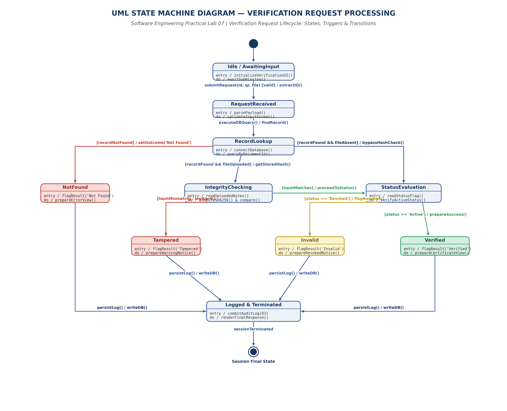

# EXPERIMENT 07: UML STATE MACHINE DIAGRAM

## 1. Experiment Number
**Lab 07**

## 2. Experiment Title
**UML State Machine Diagram for Document Verification Request Lifecycle and Outcome Evaluation in DDVS**

---

## 3. Aim / Objective
To model the reactive, event-driven state transitions of a document verification request within the Digital Document Verification System (DDVS) using a standardized UML State Machine Diagram, establishing formal states (`Idle`, `RequestReceived`, `RecordLookup`, `IntegrityChecking`, `StatusEvaluation`), deterministic guard-conditioned transitions, the four discrete terminal outcomes (`Verified`, `Tampered`, `Invalid`, `NotFound`), and final audit logging consolidation.

---

## 4. Theory / Introduction

### 4.1 Foundations of UML State Machine Diagrams
A UML State Machine Diagram (historically known as a State Transition Diagram or Harel Statechart) models the dynamic lifecycle of a system or object as it traverses a discrete series of **states** in response to external and internal **events**. It captures reactive control behavior and guarantees that at any given instant in time, an entity resides in exactly one state.

### 4.2 Key Notational Elements
1. **State**: Represented by a rounded rectangle containing the state name. Optionally partitioned into compartments detailing internal behaviors:
   - `entry / action`: Atomic action executed immediately upon entering the state.
   - `do / activity`: Ongoing computation or wait condition sustained while residing in the state.
   - `exit / action`: Action executed immediately prior to leaving the state.
2. **Initial Pseudostate**: Represented by a solid filled black circle (`●`). Marks the default starting point when an enclosing region or state machine activates.
3. **Transition**: Represented by an open-arrow directed line (`──►`) from a source state to a target state.
4. **Transition Label Syntax (`trigger [guard] / action`)**:
   - **Trigger (Event)**: An occurrence that may trigger a state change (e.g., `submitVerification`, `dbQueryReturned`).
   - **Guard Condition (`[guard]`)**: A boolean expression evaluated when the trigger occurs. If true, the transition fires; if false, it does not.
   - **Action (`/ action`)**: An atomic, non-interruptible procedure executed during transition traversal.
5. **Final State**: Represented by a bullseye circle (`⦿`). Indicates that execution within the state machine has concluded and the session is terminated.

### 4.3 Crucial Modeling Distinction: Document Lifecycle vs. Verification Request Lifecycle
In Software Engineering, distinct state models must not be conflated:
- **Document Entity Lifecycle (Persistent Entity)**: Tracks an issued credential across its operational lifespan: `Draft` ──► `Active` ──► `Revoked` / `Invalid` (persisted in `D2 Document Store`).
- **Verification Request Lifecycle (Transient Transaction)**: Models the temporal execution of a single verification session from initial web submission to verdict presentation and audit ledger persistence.
*Focus*: This laboratory experiment models the **Verification Request Lifecycle**, which governs runtime system behavior and outcome generation.

---

## 5. Requirements and Tools
- **Operating Environment**: Cross-platform (Windows / Linux / macOS)
- **Modeling Tool**: diagrams.net (draw.io) Desktop & Web Editor (v24.7+)
- **Graphic Compilation**: Python 3.13, Matplotlib (Vector PDF & 300 DPI PNG backend)
- **Source Baseline**: IEEE-standard SRS for DDVS v1.0 (Section 4.3, 4.4, 4.5, 6.2, Appendix B)

---

## 6. Detailed Procedure

### Step 1: Identification of Request States
From the SRS verification specification, six primary operational states were identified:
1. `Idle / AwaitingInput`: The client interface is initialized and waiting for user input.
2. `RequestReceived`: Verification payload has been received and parsed.
3. `RecordLookup`: The relational database is queried to find a matching document ID.
4. `IntegrityChecking`: Cryptographic SHA-256 hash is computed on an uploaded file and evaluated against the immutable registered hash.
5. `StatusEvaluation`: Document validity flag is verified (`Active` vs. `Revoked`).
6. `Logged & Terminated`: Verification transaction is committed to the immutable audit log store (`D3`) before session closure.

### Step 2: Identification of Discrete Outcome States
Four terminal classification outcomes were formalized from functional requirements FR-25, FR-27, FR-28, and FR-29:
- `NotFound`: The queried identifier does not exist in the database.
- `Tampered`: The file byte stream does not match the original hash stored at registration.
- `Invalid`: The record exists and matches cryptographic hashes, but has been administratively revoked or expired.
- `Verified`: The record exists, hashes match (or hash check was bypassed for ID/QR lookups), and the status is active.

### Step 3: Trigger, Guard, and Action Formulation
Mathematical determinism was enforced across all transitions by establishing mutually exclusive guard expressions (e.g., `[recordNotFound]` vs. `[recordFound && fileUploaded]` vs. `[recordFound && fileAbsent]`).

---

## 7. Design, Diagram, and State Specifications

### 7.1 Formal State Transition Table

| Current State | Event / Trigger | Guard Condition | Next State | Action Executed (`/ action`) | SRS Traceability |
| :--- | :--- | :--- | :--- | :--- | :--- |
| **`Initial`** | System Initialization | None | **`Idle / AwaitingInput`** | `initializeVerificationUI()` | Section 3.1 |
| **`Idle / AwaitingInput`** | `submitVerification(id, qr, file)` | `[validInputPayload]` | **`RequestReceived`** | `extractID(); parsePayload()` | FR-22–FR-24 |
| **`RequestReceived`** | `executeDBQuery()` | None | **`RecordLookup`** | `queryByDocumentId()` | Section 4.3 |
| **`RecordLookup`** | `dbResponseReceived` | `[recordNotFound]` | **`NotFound`** | `setOutcome('Not Found')` | FR-25 |
| **`RecordLookup`** | `dbResponseReceived` | `[recordFound && fileUploaded]`| **`IntegrityChecking`** | `extractStoredHash(); readBytes()` | FR-33 |
| **`RecordLookup`** | `dbResponseReceived` | `[recordFound && fileAbsent]` | **`StatusEvaluation`** | `bypassHashCheck()` | FR-26 |
| **`IntegrityChecking`** | `hashComputed` | `[hashMismatch]` | **`Tampered`** | `logSecurityAlert(); setOutcome('Tampered')` | FR-28, FR-34 |
| **`IntegrityChecking`** | `hashComputed` | `[hashMatches]` | **`StatusEvaluation`** | `proceedToStatusCheck()` | FR-33 |
| **`StatusEvaluation`** | `statusChecked` | `[status == 'Revoked' \|\| 'Invalid']` | **`Invalid`** | `flagRevoked(); setOutcome('Invalid')` | FR-29 |
| **`StatusEvaluation`** | `statusChecked` | `[status == 'Active']` | **`Verified`** | `prepareCertificateView(); setOutcome('Verified')` | FR-27 |
| **`NotFound`** | `persistOutcome` | None | **`Logged & Terminated`** | `commitAuditLog(D3); renderResponse()` | FR-37 |
| **`Tampered`** | `persistOutcome` | None | **`Logged & Terminated`** | `commitAuditLog(D3); renderResponse()` | FR-36, FR-37 |
| **`Invalid`** | `persistOutcome` | None | **`Logged & Terminated`** | `commitAuditLog(D3); renderResponse()` | FR-37 |
| **`Verified`** | `persistOutcome` | None | **`Logged & Terminated`** | `commitAuditLog(D3); renderResponse()` | FR-37 |
| **`Logged & Terminated`**| `sessionClosed` | None | **`Final State (⦿)`** | `cleanupSession()` | FR-10 |

---

### 7.2 Entity State Machine Comparison (Document vs. Verification Request)

```
[Document Entity Lifecycle (Persistent)]
  (●) ──► [Draft] ──► [Active / Issued] ──► [Revoked / Invalid] ──► (⦿ Soft-Deleted)

[Verification Request Lifecycle (Transient Transaction)]
  (●) ──► [Idle] ──► [RequestReceived] ──► [RecordLookup]
                                                │
                 ┌──────────────────────────────┼──────────────────────────────┐
                 ▼                              ▼                              ▼
            [NotFound]                 [IntegrityChecking]            [StatusEvaluation]
                 │                              │                              │
                 │                      ┌───────┴───────┐              ┌───────┴───────┐
                 │                      ▼               ▼              ▼               ▼
                 │                 [Tampered]   [StatusEvaluation] [Invalid]      [Verified]
                 │                      │               │              │               │
                 └──────────────────────┴───────────────┼──────────────┴───────────────┘
                                                        ▼
                                             [Logged & Terminated] ──► (⦿)
```

---

## 8. UML State Machine Diagram Artifacts

The UML State Machine Diagram has been compiled in three standard formats:
- **Editable Source**: [`DDVS_Lab07_State_Transition_Diagram.drawio`](file:///e:/Digital-Document-Verification-System/Lab-07-State-Transition-Diagram/DDVS_Lab07_State_Transition_Diagram.drawio)
- **Vector Document**: [`DDVS_Lab07_State_Transition_Diagram.pdf`](file:///e:/Digital-Document-Verification-System/Lab-07-State-Transition-Diagram/DDVS_Lab07_State_Transition_Diagram.pdf)
- **High-Resolution Graphic**: [`DDVS_Lab07_State_Transition_Diagram.png`](file:///e:/Digital-Document-Verification-System/Lab-07-State-Transition-Diagram/DDVS_Lab07_State_Transition_Diagram.png)



---

## 9. Explanation and Analysis

### 9.1 Mathematical Determinism and Guard Completeness
A fundamental requirement of state machine engineering is **determinism**: from any source state, no two outgoing transitions with the same trigger may evaluate to true simultaneously.
- In `RecordLookup`, the three outgoing guards (`recordNotFound`, `recordFound && fileUploaded`, `recordFound && fileAbsent`) form a complete partition of all possible database outcomes.
- In `IntegrityChecking`, the binary branch (`hashMismatch` vs. `hashMatches`) covers all cryptographic comparison outcomes.
- In `StatusEvaluation`, the binary status check (`status == 'Active'` vs. `status != 'Active'`) is exhaustive.
This mathematical closure prevents state ambiguity and deadlocks during verification processing.

### 9.2 Decoupled Integrity Verification Pathway
The state transition diagram explicitly formalizes how the system reacts when a verifier inspects a printed credential (QR code or ID text) without uploading a file.
- The transition `[recordFound && fileAbsent] / bypassHashCheck()` routes execution directly from `RecordLookup` to `StatusEvaluation`.
- This ensures the state machine does not stall waiting for a file stream, preserving compliance with SRS FR-26.

### 9.3 Inviolable Consolidation into `Logged & Terminated`
In naive designs, each outcome state terminates independently, leading to code duplication and missed audit logging.
- By channeling all four outcome states (`NotFound`, `Tampered`, `Invalid`, `Verified`) into a dedicated **`Logged & Terminated`** state via `persistOutcome`, DDVS enforces centralized audit commit logic.
- The audit record in data store `D3` is guaranteed to capture the exact outcome state reached, ensuring 100% forensic auditability.

---

## 10. Result and Conclusion

### 10.1 Result
The dynamic state behavior of verification processing in DDVS was modeled using a standardized UML State Machine Diagram. All states, entry/do activities, guarded transitions, and outcome classifications were verified and exported into `.drawio`, `.pdf`, and `.png` formats accompanied by an exhaustive State Transition Table.

### 10.2 Conclusion
The state machine diagram establishes an unambiguous, deterministic state model for the DDVS verification engine. It cleanly delineates transient session processing from permanent document lifecycles, ensures fault-tolerant bypass paths, and guarantees audit trail preservation across all execution branches.
