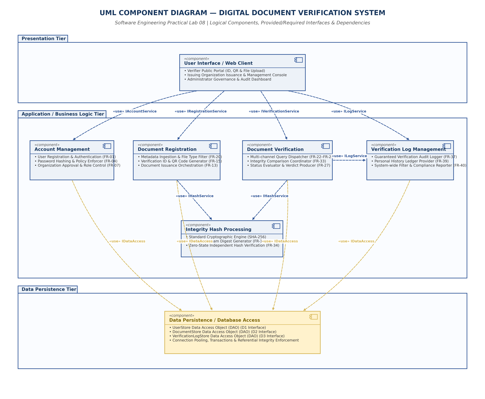

# EXPERIMENT 08: UML COMPONENT DIAGRAM

## 1. Experiment Number
**Lab 08**

## 2. Experiment Title
**UML Component Diagram: Logical Software Architecture, Interfaces, and Subsystem Dependencies for DDVS**

---

## 3. Aim / Objective
To design and model the high-level logical component architecture of the Digital Document Verification System (DDVS) using a standardized UML Component Diagram, identifying seven decoupled functional components across three architectural tiers (Presentation, Application Business Logic, and Data Persistence), formalizing provided and required interfaces (`IAccountService`, `IRegistrationService`, `IVerificationService`, `IHashService`, `ILogService`, `IDataAccess`), and evaluating subsystem dependencies.

---

## 4. Theory / Introduction

### 4.1 Foundations of UML Component Diagrams
A UML Component Diagram is a structural modeling diagram that illustrates the modular organization, interfaces, ports, and physical or logical dependencies among software components. It abstracts away internal algorithmic and class-level implementation details to focus on **subsystem boundaries, replaceable service units, and contract-driven communication**.

### 4.2 Key Notational Elements
1. **Component (`«component»`)**: Represented by a rectangle with a small two-tabbed component icon in the upper-right corner (or the standard UML 2.x `«component»` stereotype). Represents an encapsulated, modular, cohesive unit of software that satisfies and provides access to specified interfaces.
2. **Interface**: A formal specification of operations and services offered or required by a component:
   - **Provided Interface (`«provided»` / Ball or Lollipop `—○`)**: A service or API exposed by the component to its environment.
   - **Required Interface (`«required»` / Socket or Cup `—)`)**: A service or dependency that a component must consume from another component to fulfill its contractual responsibilities.
3. **Dependency (`«use»`)**: Represented by a dashed directed line (`- - -►`) extending from a client component to a target component or interface, indicating that a change in the target may necessitate a modification in the client.
4. **Subsystem Package / Tier Boundary**: Visual grouping containers depicting architectural layers (e.g., *Presentation Tier*, *Business Logic Tier*, *Data Persistence Tier*).

### 4.3 Class Diagram vs. Component Diagram
- **Class Diagram (Lab 03)**: Models fine-grained, object-oriented concepts at compile-time (attributes, methods, visibilities, inheritance, and multiplicities).
- **Component Diagram (Lab 08)**: Models coarse-grained, deployable, runtime modular subsystems, service boundaries, and integration contracts.

---

## 5. Requirements and Tools
- **Operating Environment**: Cross-platform (Windows / Linux / macOS)
- **Modeling Tool**: diagrams.net (draw.io) Desktop & Web Editor (v24.7+)
- **Graphic Compilation**: Python 3.13, Matplotlib (Vector PDF & 300 DPI PNG backend)
- **Source Baseline**: IEEE-standard SRS for DDVS v1.0 (Section 2.1, Section 3.1–3.4, Section 4.1–4.6, Appendix B)

---

## 6. Detailed Procedure

### Step 1: Identification of Logical Components
In accordance with the master requirements and the SRS specification, seven logical subsystems were derived:
1. **`User Interface / Web Client Component`** (Presentation Tier)
2. **`Account Management Component`** (Application Tier)
3. **`Document Registration Component`** (Application Tier)
4. **`Document Verification Component`** (Application Tier)
5. **`Integrity Hash Processing Component`** (Application Tier / Utility)
6. **`Verification Log Management Component`** (Application Tier)
7. **`Data Persistence / Database Access Component`** (Persistence Tier)

*Crucial Design Assumption*: These components represent **logical software subsystems**, not proprietary framework artifacts. No specific vendor runtime (e.g., React, Spring Boot, Node.js, PostgreSQL) is prematurely enforced, preserving architectural neutrality as requested by the SRS (Section 2.1, Appendix C TBD-01).

### Step 2: Layered Tier Assignment
The components were arranged across three standardized architectural layers:
- **Presentation Tier**: User Interface & Web Client (capturing verifier, issuer, and admin interaction).
- **Business Logic Tier (Application Server)**: Core processing engines for accounts, document registration, verification evaluation, hashing, and audit logging.
- **Data Persistence Tier**: Centralized data access abstraction encapsulating relational database CRUD operations.

### Step 3: Interface Definition and Dependency Mapping
Provided and required interface contracts were defined:
- `IAccountService`: Exposes registration, login, logout, password change, and admin role management.
- `IRegistrationService`: Exposes document metadata ingestion, file upload validation, and QR generation.
- `IVerificationService`: Exposes query parsing, lookup coordination, status checks, and outcome synthesis.
- `IHashService`: Exposes stateless SHA-256 cryptographic digest calculation and byte comparison.
- `ILogService`: Exposes immutable verification audit logging, verifier history, and administrative log filtering.
- `IDataAccess`: Exposes database access objects (DAOs) for User, Document, and Log stores.

---

## 7. Diagram, Specifications, and Component Responsibilities

### 7.1 Component Responsibility Table

| Component Name | Architectural Tier | Primary Responsibility | Inputs | Outputs | Provided Interface | Required Interface |
| :--- | :--- | :--- | :--- | :--- | :--- | :--- |
| **User Interface / Web Client** | Presentation | Renders dashboards, captures forms, handles client validation, and displays verification feedback. | User input, touch/click events, HTTP responses | Form payloads, HTTPS requests | `IWebUI` | `IAccountService`, `IRegistrationService`, `IVerificationService`, `ILogService` |
| **Account Management** | Business Logic | Manages credential security, user sessions, role-based access, and organization review. | Registration forms, login credentials, admin approval directives | Auth tokens, account status, user profiles | `IAccountService` | `IDataAccess` |
| **Document Registration** | Business Logic | Orchestrates document issuance, generates Verification IDs, and requests QR codes and hashes. | Document metadata, PDF byte stream, issuer orgId | Verification ID, QR image payload, issuance status | `IRegistrationService`| `IHashService`, `IDataAccess` |
| **Document Verification** | Business Logic | Coordinates document query resolution, hash comparisons, status evaluation, and verdict generation. | Verification query (ID/QR/File), client IP | Verification verdict (`Verified`, `Tampered`, `Invalid`, `Not Found`) | `IVerificationService`| `IHashService`, `ILogService`, `IDataAccess` |
| **Integrity Hash Processing** | Business Logic (Utility) | Executes cryptographic hashing on submitted binary files using standard SHA-256 algorithms. | Binary byte stream / file handle | 64-character hexadecimal SHA-256 digest | `IHashService` | None (Stateless) |
| **Verification Log Management** | Business Logic | Appends immutable records of verification transactions and generates filtered compliance audit reports. | Verification event tokens, verifier ID, client IP | Formatted audit records, personal history, audit logs | `ILogService` | `IDataAccess` |
| **Data Persistence / DB Access** | Data Persistence | Encapsulates relational queries, enforces foreign-key referential integrity, and handles connection pooling. | Domain entities, DAO method invocations | Persisted tuples, record query results | `IDataAccess` | Relational DBMS Connection |

---

### 7.2 Interface Method Signatures

```
+----------------------------------------------------------------------------------------------------+
|                                    COMPONENT INTERFACE DEFINITIONS                                 |
+----------------------------------------------------------------------------------------------------+
| interface IAccountService {                                                                        |
|   + registerUser(name: String, email: String, pass: String): Boolean                               |
|   + authenticate(credentials: Map): SessionToken                                                   |
|   + approveOrganization(orgId: String): Boolean                                                    |
|   + updateAccountStatus(userId: String, active: Boolean): Boolean                                  |
| }                                                                                                  |
|                                                                                                    |
| interface IRegistrationService {                                                                   |
|   + registerDocument(metadata: DocMeta, fileStream: Stream): DocReceipt                            |
|   + generateVerificationId(): String                                                               |
|   + generateQRCode(verificationId: String): ByteStream                                             |
|   + revokeDocument(docId: String, reason: String): Boolean                                         |
| }                                                                                                  |
|                                                                                                    |
| interface IVerificationService {                                                                   |
|   + verifyDocument(payload: VerifyPayload, clientIp: String): VerificationVerdict                   |
| }                                                                                                  |
|                                                                                                    |
| interface IHashService {                                                                           |
|   + computeSHA256(byteStream: Stream): String                                                      |
|   + compareHashes(computedHash: String, storedHash: String): Boolean                               |
| }                                                                                                  |
|                                                                                                    |
| interface ILogService {                                                                            |
|   + appendLogEntry(event: VerificationEvent): Boolean                                              |
|   + getUserHistory(userId: String): List<VerificationLog>                                          |
|   + queryAuditLogs(filter: FilterParams): List<VerificationLog>                                    |
| }                                                                                                  |
|                                                                                                    |
| interface IDataAccess {                                                                            |
|   + findUserByEmail(email: String): UserRecord                                                     |
|   + saveUser(user: UserRecord): Boolean                                                            |
|   + findDocumentById(docId: String): DocumentRecord                                                |
|   + saveDocument(doc: DocumentRecord): Boolean                                                     |
|   + appendVerificationLog(log: LogRecord): Boolean                                                 |
| }                                                                                                  |
+----------------------------------------------------------------------------------------------------+
```

---

## 8. UML Component Diagram Artifacts

The UML Component Diagram has been compiled in three standard formats:
- **Editable Source**: [`DDVS_Lab08_Component_Diagram.drawio`](file:///e:/Digital-Document-Verification-System/Lab-08-Component-Diagram/DDVS_Lab08_Component_Diagram.drawio)
- **Vector Document**: [`DDVS_Lab08_Component_Diagram.pdf`](file:///e:/Digital-Document-Verification-System/Lab-08-Component-Diagram/DDVS_Lab08_Component_Diagram.pdf)
- **High-Resolution Graphic**: [`DDVS_Lab08_Component_Diagram.png`](file:///e:/Digital-Document-Verification-System/Lab-08-Component-Diagram/DDVS_Lab08_Component_Diagram.png)



---

## 9. Explanation and Analysis

### 9.1 High Cohesion and Single-Responsibility Principle
Each of the seven components encapsulates a single, tightly focused functional area:
- `Account Management` deals exclusively with user identity and security tokens; it has no knowledge of PDF formats or verification algorithms.
- `Integrity Hash Processing` is a pure mathematical calculation engine with **zero state and zero dependencies**; it takes an input byte stream and emits a hash digest.
- `Document Verification` acts as a coordinator, delegating hash calculations to `IHashService` and audit records to `ILogService`.

### 9.2 Loose Coupling via Interface Inversion
No business logic component depends directly on a concrete database implementation.
- All four business components (`Account Management`, `Document Registration`, `Document Verification`, `Verification Log Management`) communicate with persistence exclusively through the `IDataAccess` interface.
- This adheres strictly to the **Dependency Inversion Principle (DIP)**. If the persistence tier changes from a relational DBMS to an encrypted document store or distributed ledger in future releases, zero modifications are required in the business logic tier.

### 9.3 Testability and Replaceability
Because components interact strictly through documented interfaces:
- Individual components can be isolated and unit-tested by injecting mock implementations (e.g., a mock `IHashService` or in-memory `IDataAccess`).
- The `User Interface` component can be developed independently as a Single Page Application (SPA), mobile client, or third-party API gateway without disrupting backend components.

---

## 10. Result and Conclusion

### 10.1 Result
A complete UML Component Diagram for the Digital Document Verification System was architected. All seven logical components, their assigned tiers, provided/required interfaces, and inter-subsystem dependencies were modeled and verified in `.drawio`, `.pdf`, and `.png` formats supported by complete interface specifications.

### 10.2 Conclusion
The component architecture establishes a scalable, decoupled, and maintainable software structure for DDVS. By enforcing three-tier separation, abstracting persistence mechanisms, and isolating cryptographic utilities, the design establishes high software quality and provides a dependable transition path from theoretical models to production software engineering.
