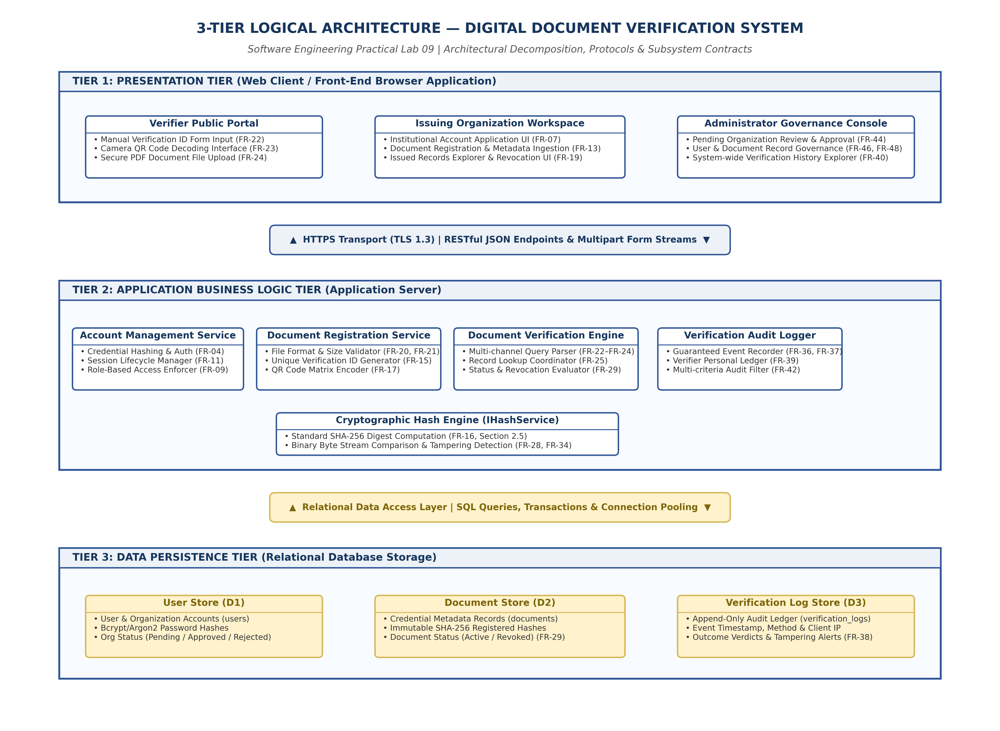

# EXPERIMENT 09: SOFTWARE DESIGN ANALYSIS REPORT

## 1. Experiment Number
**Lab 09**

## 2. Experiment Title
**Software Design Analysis Report: Architectural Decomposition, Modularity, Cohesion, Coupling, and Quality Attributes for DDVS**

---

## Project and Team Information
- **Project Title:** Digital Document Verification System (DDVS)
- **Team Size:** 4 Members
- **Project Team Members:**
  1. Divya Kumari
  2. Divyanshi Jaiswal
  3. Divyanshi Khemani
  4. Divyanshu Gupta
- **Course / Subject:** B.Tech Computer Science & Engineering — Software Engineering Laboratory
- **Authoritative Baseline:** IEEE-Standard SRS for DDVS v1.0 (August 31, 2026)

---

## Deliverables Summary and Moodle Submission Files
- **Moodle Submission Document (DOCX):** [`DDVS_Lab09_Design_Analysis.docx`](DOCX/DDVS_Lab09_Design_Analysis.docx) *(Located in `DOCX/` subfolder with embedded architecture diagram)*
- **Formal Academic Report (PDF):** [`DDVS_Lab09_Design_Analysis_Report.pdf`](DDVS_Lab09_Design_Analysis_Report.pdf)
- **Editable Draw.io Diagram:** [`DDVS_Lab09_Architecture_Diagram.drawio`](DDVS_Lab09_Architecture_Diagram.drawio)
- **Vector PDF Export:** [`DDVS_Lab09_Architecture_Diagram.pdf`](DDVS_Lab09_Architecture_Diagram.pdf)
- **High-Resolution PNG Preview:** [`DDVS_Lab09_Architecture_Diagram.png`](DDVS_Lab09_Architecture_Diagram.png)

---

## 3. Aim / Objective
To conduct a comprehensive, academically rigorous software design analysis of the Digital Document Verification System (DDVS), evaluating its three-tier logical architecture, modular decomposition, intra-module cohesion, inter-subsystem coupling, non-functional quality attributes (maintainability, scalability, reliability, and security), and architectural constraints in accordance with established Software Engineering principles (IEEE and ISO/IEC 25010 standards).

---

## 4. Theory / Introduction

### 4.1 Relationship Between Requirements Engineering and Software Architecture
Software architecture is the bridge between user requirements (established in the Software Requirements Specification; Lab 01) and physical software construction. While requirements engineering defines *what* problem the system must solve, architectural design defines *how* the solution will be structured into collaborating components, what design patterns will be utilized, how quality attributes will be achieved, and how architectural trade-offs will be managed.

A high-quality software design adheres to five fundamental design tenets:
1. **Separation of Concerns (SoC)**: Dividing a software system into distinct sections such that each section addresses a separate concern (e.g., separating user interface presentation from business rules and data persistence).
2. **High Functional Cohesion**: Ensuring that all elements inside a single module are focused exclusively on performing a single, well-defined task.
3. **Low / Loose Coupling**: Minimizing dependencies between modules, ensuring that changes within one module do not ripple destructively through the rest of the codebase.
4. **Information Hiding (Abstraction)**: Concealing the internal implementation details and data representations of a module behind stable, public interface contracts.
5. **Architectural Determinism**: Ensuring that all execution pathways produce predictable, mathematically verifiable outcomes across all normal, exceptional, and security-compromised operating conditions.

---

## 5. Requirements and Tools
- **Operating Environment**: Cross-platform (Windows / Linux / macOS)
- **Analytical Framework**: ISO/IEC 25010 System and Software Quality Models
- **Report Generation Engine**: Python 3.13, ReportLab PDF Engine (v5.1+), Matplotlib (v3.10+)
- **Diagramming Environment**: diagrams.net (draw.io)
- **Baseline Design Models**: Completed Labs 01 through 08 of the DDVS Project

---

## 6. Detailed Architectural Analysis

### 6.1 Three-Tier Logical Architecture Decomposition
The Digital Document Verification System is organized according to a strict **Three-Tier Logical Architecture**, ensuring clear separation between user presentation, transactional business processing, and persistent state storage:

```
+----------------------------------------------------------------------------------------------------+
|                                    3-TIER LOGICAL ARCHITECTURE                                     |
+----------------------------------------------------------------------------------------------------+
| TIER 1: PRESENTATION TIER (Web Client / Front-End Browser Application)                             |
|   ├── Verifier Portal (ID Entry, Camera QR Scanner, PDF Document Upload)                          |
|   ├── Issuing Organization Console (Registration Form, Document Issuance, Records Dashboard)       |
|   └── Administrator Governance Console (Org Review, User Management, Audit Log Viewer)             |
+----------------------------------------------------------------------------------------------------+
                                                  ▲
                                                  │ HTTPS Transport (TLS 1.3) / RESTful JSON / Forms
                                                  ▼
+----------------------------------------------------------------------------------------------------+
| TIER 2: APPLICATION BUSINESS LOGIC TIER (Application Server)                                       |
|   ├── Account Management Service (Authentication, Bcrypt Hashing, RBAC, Session Lifecycle)        |
|   ├── Document Registration Service (Metadata Validation, Verification ID & QR Code Generation)   |
|   ├── Document Verification Engine (Query Parsing, Record Lookup, Status Evaluation)               |
|   ├── Cryptographic Hash Engine (Stateless SHA-256 Digest & Binary Tampering Comparison)           |
|   └── Verification Audit Logger (Guaranteed Append-Only Log Commit, Audit Queries)                 |
+----------------------------------------------------------------------------------------------------+
                                                  ▲
                                                  │ Relational Database Client / SQL Connection Pool
                                                  ▼
+----------------------------------------------------------------------------------------------------+
| TIER 3: DATA PERSISTENCE TIER (Relational Database Storage)                                        |
|   ├── User Store (D1) [users, issuing_organizations tables]                                        |
|   ├── Document Store (D2) [documents table - metadata, immutable SHA-256 hashes, status flags]     |
|   └── Verification Log Store (D3) [verification_logs table - append-only audit trail]              |
+----------------------------------------------------------------------------------------------------+
```

### 6.2 Architectural Artifacts
- **Editable Source**: [`DDVS_Lab09_Architecture_Diagram.drawio`](DDVS_Lab09_Architecture_Diagram.drawio)
- **Vector Document**: [`DDVS_Lab09_Architecture_Diagram.pdf`](DDVS_Lab09_Architecture_Diagram.pdf)
- **High-Resolution Graphic**: [`DDVS_Lab09_Architecture_Diagram.png`](DDVS_Lab09_Architecture_Diagram.png)
- **Formal Academic Report PDF**: [`DDVS_Lab09_Design_Analysis_Report.pdf`](DDVS_Lab09_Design_Analysis_Report.pdf)



---

## 7. In-Depth Evaluation of Software Engineering Principles

### 7.1 Modularity Analysis
Modularity evaluates how effectively the system is partitioned into independent, cohesive subsystems. DDVS decomposes core responsibilities across seven logical modules:
1. **User Interface / Web Client**: Handles input capture and feedback rendering without containing business logic.
2. **Account Management**: Encapsulates credential validation, hashing, and role-based permissions.
3. **Document Registration**: Manages the issuance lifecycle and unique identifier creation.
4. **Document Verification**: Serves as the central transaction coordinator.
5. **Integrity Hash Processing**: Operates as a pure, zero-state mathematical utility.
6. **Verification Log Management**: Manages immutable audit ledgers and compliance history.
7. **Data Persistence / Database Access**: Encapsulates SQL generation and connection pooling.

*Benefits of this Modular Structure*:
- **Comprehensibility**: Individual modules can be understood, analyzed, and debugged in isolation without requiring complete system comprehension.
- **Parallel Development**: Frontend engineering (Tier 1), core business logic (Tier 2), and database schema administration (Tier 3) can proceed concurrently against documented interface contracts.
- **Fault Containment**: An uncaught runtime failure during file parsing or image decoding in the presentation layer is isolated and prevented from corrupting backend database states.

---

### 7.2 Cohesion Analysis
Cohesion measures the strength of functional relatedness among elements within a single module. In established Software Engineering theory (Yourdon & Constantine), cohesion levels are categorized from lowest (worst) to highest (best):
1. *Coincidental Cohesion* (Arbitrary grouping; poorest quality)
2. *Logical Cohesion* (Grouping by category, e.g., a "MathUtils" class doing unrelated operations)
3. *Temporal Cohesion* (Grouping by time of execution, e.g., "startup_initialization()")
4. *Procedural Cohesion* (Grouping to enforce sequence of execution)
5. *Communicational Cohesion* (Grouping operations that operate on the same data structure)
6. *Sequential Cohesion* (Output of one operation becomes input to the next)
7. *Functional Cohesion* (Every element contributes strictly to executing a single, well-defined objective; highest quality)

#### Detailed Module Cohesion Evaluation for DDVS:

| Subsystem / Module | Observed Cohesion Level | Engineering Justification & Architectural Evidence |
| :--- | :--- | :--- |
| **Account Management** | **Functional Cohesion** | Every method (`register`, `login`, `changePassword`, `approveOrg`) contributes strictly to managing authenticated identity and authorization rights. No document or hashing logic is present. |
| **Document Registration** | **Sequential & Functional** | Operations follow a strict sequential data pipeline: validate metadata ──► compute SHA-256 hash ──► generate verification ID ──► persist document. Each step consumes the output of the preceding step. |
| **Document Verification** | **Functional Cohesion** | Focuses exclusively on evaluating credential validity: parsing query ──► coordinating lookup ──► coordinating hash check ──► synthesizing verdict. |
| **Integrity Hash Processing** | **Pure Functional Cohesion** | Performs exactly one mathematical task: taking a binary byte stream and computing a 256-bit SHA-256 digest. It maintains zero state, zero side-effects, and zero external dependencies. |
| **Verification Log Management** | **Functional Cohesion** | Dedicated strictly to immutable audit logging and compliance history querying. Audit logic is completely decoupled from verification decision branching. |

*Verdict*: The DDVS architecture exhibits uniformly high **Functional and Sequential Cohesion**, avoiding lower anti-patterns like coincidental or purely logical grouping.

---

### 7.3 Coupling Analysis
Coupling characterizes the degree of interdependence between different software modules. In Software Engineering, coupling levels are classified from highest/tightest (worst) to lowest/loosest (best):
1. *Content Coupling* (One module directly accesses or modifies internal data/code of another; worst)
2. *Common Coupling* (Modules share global variables or global mutable memory)
3. *Control Coupling* (One module controls the internal execution flow of another by passing control flags)
4. *Stamp Coupling* (Modules share a composite data structure, even if only a subset of fields is utilized)
5. *Data Coupling* (Modules communicate strictly by passing discrete, primitive data parameters; best)

#### Detailed Module Coupling Evaluation for DDVS:

| Inter-Module Boundary | Observed Coupling Level | Engineering Safeguard & Mitigation Strategy |
| :--- | :--- | :--- |
| **Web Client ──► Business Services** | **Data / Stamp Coupling** | Client communicates with Application Server over HTTPS passing structured JSON requests and receiving JSON responses. No internal server memory is accessible. |
| **Verification Engine ──► Hash Service** | **Pure Data Coupling** | Verification engine passes an input file stream handle and receives a primitive 64-character hexadecimal string digest. The hash engine possesses zero knowledge of domain entities. |
| **Verification Engine ──► Log Service** | **Data Coupling** | Verification engine passes an immutable `VerificationEvent` record (ID, timestamp, method, result) to the logger. No internal log store logic is exposed. |
| **Business Services ──► Persistence Tier** | **Stamp / Data Coupling** | Business modules communicate via the `IDataAccess` interface using discrete Data Transfer Objects (DTOs). Raw SQL queries and database connection handles are encapsulated within DAOs. |

*Verdict*: **Content and Common coupling are completely eradicated**. Global mutable variables are strictly banned. By enforcing interface-driven dependencies (`IDataAccess`, `IHashService`), DDVS achieves loose, maintainable coupling.

---

## 8. Non-Functional Software Quality Attributes

### 8.1 Maintainability and Extensibility
- **Interface Segregation**: By defining specific interfaces (`IAccountService`, `IRegistrationService`, `IVerificationService`, `IHashService`, `ILogService`, `IDataAccess`), any module can be modified or refactored without breaking neighboring components.
- **Cryptographic Extensibility**: If security standards require upgrading from SHA-256 to SHA-512 or post-quantum signature schemes, only the `Integrity Hash Processing` component requires code updates. All database schemas and verification workflows remain unaffected.

### 8.2 Architectural Scalability
- **Stateless Application Server**: Tier 2 application server instances do not store sticky in-memory session states. Sessions are authenticated via cryptographically signed tokens or centralized cache stores, allowing horizontal auto-scaling behind an HTTPS load balancer.
- **Database Optimization**: Document verification is a read-heavy workload (90%+ read ratio). Scalability is supported by configuring relational read-replicas, indexing `documentId` with B-tree structures, and implementing edge caching for frequently verified public records.

### 8.3 Reliability and Fault Tolerance
- **Deterministic Outcome States**: As mathematically proven in Lab 07, the verification state machine guarantees deterministic outcomes (`Verified`, `Tampered`, `Invalid`, `NotFound`).
- **Guaranteed Audit Integrity**: In accordance with SRS FR-36 and FR-37, verification logging is executed synchronously prior to returning HTTP responses, guaranteeing 100% audit trail completeness even if client networks drop.

### 8.4 Multi-Tier Security Architecture
- **Transport Security**: Mandatory HTTPS / TLS 1.3 across all client-server communications (FR-09, Section 3.4).
- **Credential Protection**: Passwords stored exclusively as one-way cryptographic hashes using salted algorithms (e.g., bcrypt/Argon2; FR-04). Plaintext passwords are never persisted or logged.
- **Role-Based Access Control (RBAC)**: Document registration is restricted exclusively to administrators-approved issuing organizations (FR-08, FR-44).
- **Cryptographic Tampering Detection**: Mathematical SHA-256 checksum comparison provides deterministic protection against post-issuance file tampering (FR-28, FR-34).

---

## 9. Design Limitations and Engineering Roadmap

A rigorous academic evaluation requires acknowledging current design constraints:

| Constraint / Limitation | Architectural Root Cause | Production Engineering Roadmap |
| :--- | :--- | :--- |
| **1. Centralized Authority Vulnerability** | Relational database serves as the single source of truth; malicious database administrators could theoretically alter records. | Anchor document hash digests into a public or permissioned **Consortium Blockchain / Distributed Ledger** for decentralized tamper-resistance. |
| **2. Storage Scalability for Large Files** | Uploading large document files (up to 10 MB; FR-21) directly to application servers risks memory and disk exhaustion. | Offload file storage to a cloud **Object Storage Bucket** (e.g., AWS S3 / GCS) and store only cryptographic URI links in the database. |
| **3. Lack of Physical Print Verification** | Cryptographic hash matching works exclusively on original digital byte streams; scanned copies of printed paper documents cannot be bitwise compared. | Implement an automated **Optical Character Recognition (OCR) and layout analysis pipeline** to extract and verify printed text fields. |
| **4. Privacy in Public Verifications** | Public verifications (FR-30) return recipient names to any user holding a valid ID, posing data privacy risks. | Incorporate **Zero-Knowledge Proofs (ZKP)** or selective disclosure to confirm document authenticity without exposing personal identifiable information (PII). |

---

## 10. Result and Conclusion

### 10.1 Result
A complete Software Design Analysis Report for the Digital Document Verification System was authored, supported by:
1. A formal 3-Tier Logical Architecture Diagram exported in `.drawio`, `.pdf`, and `.png` formats.
2. An exhaustive 5-page formal academic report compiled to publication standards in [`DDVS_Lab09_Design_Analysis_Report.pdf`](DDVS_Lab09_Design_Analysis_Report.pdf).
3. Detailed evaluations of Modularity, Cohesion, Coupling, Maintainability, Scalability, Reliability, and Security.

### 10.2 Conclusion
The architectural evaluation confirms that the Digital Document Verification System adheres to sound Software Engineering practices. By enforcing three-tier separation of concerns, high functional cohesion, loose interface-driven coupling, deterministic verification logic, and multi-layered security safeguards, the design establishes a dependable, maintainable, and scalable software baseline.

