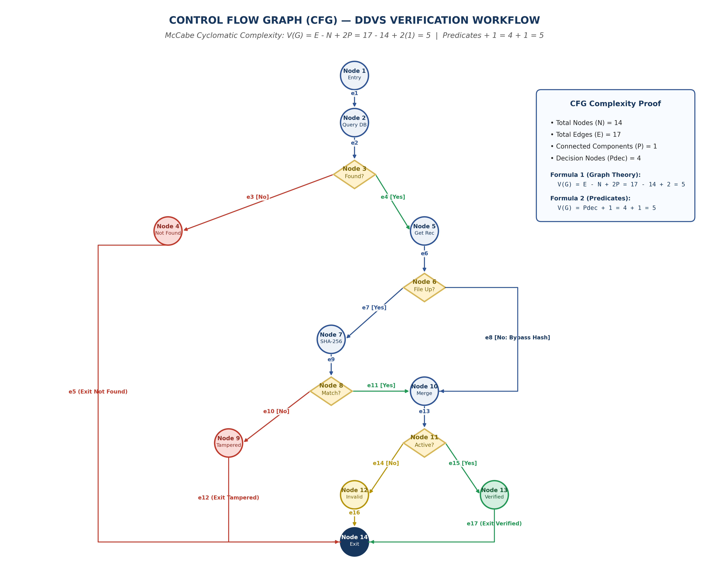

# EXPERIMENT 10: SOFTWARE METRICS AND COMPLEXITY ANALYSIS

## 1. Experiment Number
**Lab 10**

## 2. Experiment Title
**Software Metrics and Complexity Analysis: McCabe's Cyclomatic Complexity, Control Flow Graph (CFG), and Chidamber & Kemerer (CK) Object-Oriented Metric Evaluation for DDVS**

---

## 3. Aim / Objective
To quantitatively analyze the algorithmic and structural complexity of the Digital Document Verification System (DDVS) by:
1. Constructing a formal **Control Flow Graph (CFG)** of the core document verification workflow.
2. Mathematically calculating **McCabe's Cyclomatic Complexity** using multiple graph-theoretic formulas and enumerating the independent basis paths.
3. Conducting an honest **Lines of Code (LOC)** assessment distinguishing design-stage estimations from post-implementation measurements.
4. Computing the **Chidamber & Kemerer (CK) Object-Oriented Metrics Suite** (WMC, DIT, NOC, CBO, RFC, and LCOM) derived from the UML Class Diagram.
5. Formulating architectural recommendations to prevent complexity escalation.

---

## 4. Theory / Introduction

### 4.1 Foundations of Software Measurement
Software measurement provides objective, quantitative assessments of software artifacts, development processes, and project resources. In Software Engineering, metrics enable engineers to evaluate quality attributes, estimate testing effort, predict fault-proneness, and guide refactoring.

### 4.2 Taxonomy of Software Engineering Metrics
1. **Product Metrics**: Quantify internal and external characteristics of software artifacts (specifications, architectural models, designs, and codebases).
   - *Examples*: Cyclomatic Complexity, Lines of Code (LOC), Coupling Between Objects (CBO), Depth of Inheritance (DIT).
2. **Process Metrics**: Quantify the efficiency, maturity, and quality of the software development lifecycle.
   - *Examples*: Defect arrival rate, bug removal efficiency, lead time for changes, code review velocity.
3. **Project Metrics**: Quantify operational effort, cost, and scheduling progress.
   - *Examples*: Person-months of effort, milestone slip rate, team velocity, budget consumption.

---

## 5. Requirements and Tools
- **Operating Environment**: Cross-platform (Windows / Linux / macOS)
- **Analytical Metrics**: McCabe Cyclomatic Complexity, Halstead Software Science, Chidamber & Kemerer (CK) Metric Suite
- **Graphic Compilation**: Python 3.13, ReportLab PDF Engine (v5.1+), Matplotlib (v3.10+)
- **Diagramming Tool**: diagrams.net (draw.io)
- **Baseline Models**: DDVS SRS v1.0, Lab 03 (Class Diagram), Lab 04 (Activity Diagram), Lab 06 (Sequence Diagram)

---

## 6. Detailed Procedure

### Step 1: Control Flow Graph (CFG) Construction
The verification engine workflow established in the SRS (Section 4.3, 4.4) was mapped to a formal directed graph $G = (N, E)$, where each node $n \in N$ represents a sequential block of instructions or a decision fork, and each directed edge $e \in E$ represents a transfer of control.

### Step 2: Cyclomatic Complexity Mathematical Calculation
Three independent mathematical formulations were evaluated to confirm topological consistency:
1. *Graph Topology Formula*: $V(G) = E - N + 2P$
2. *Predicate Node Formula*: $V(G) = P_{dec} + 1$
3. *Planar Region Formula*: $V(G) = \text{Enclosed Regions} + \text{Unbounded Region}$

### Step 3: Basis Path Identification
A set of linearly independent execution paths was extracted to establish the minimum test suite required for 100% basis path coverage.

### Step 4: Object-Oriented Metrics Computation
Structural metrics from the Chidamber & Kemerer (CK) suite were evaluated against the six domain classes defined in the UML Class Diagram (Lab 03).

### Step 5: Academic Integrity Verification
Every metric was classified into one of three rigorous categories:
- **Measured**: Quantified directly from concrete source code (not applicable at design stage).
- **Design-Calculated / Estimated**: Calculated mathematically from structural UML models.
- **Illustrative**: Applied to hypothetical execution scenarios for theoretical demonstration.

---

## 7. Control Flow Graph and McCabe Cyclomatic Complexity Analysis

### 7.1 Control Flow Graph Node & Edge Mapping

```
      (Node 1: Entry / Parse Request)
                    │ e1
                    ▼
          (Node 2: Query DB)
                    │ e2
                    ▼
        ◇ Node 3: Record Found? (D1)
        ├── e3 [No] ──────────────────────────► (Node 4: Not Found Action) ──► e5 ──┐
        │                                                                           │
        └── e4 [Yes]                                                                │
              │                                                                     │
              ▼                                                                     │
    (Node 5: Get Record & Status)                                                   │
              │ e6                                                                  │
              ▼                                                                     │
      ◇ Node 6: File Uploaded? (D2)                                                 │
      ├── e7 [Yes] ──► (Node 7: SHA-256 Hash) ──► e9 ──┐                             │
      │                                                ▼                            │
      │                                    ◇ Node 8: Hash Matches? (D3)             │
      │                                    ├── e10 [No] ──► (Node 9: Tampered) ──► e12
      │                                    │                                        │
      │                                    └── e11 [Yes]                            │
      │                                          │                                  │
      └── e8 [No: Bypass Hash] ──────────────────┴──► (Node 10: Merge Node)         │
                                                            │ e13                   │
                                                            ▼                       │
                                                ◇ Node 11: Status Active? (D4)      │
                                                ├── e14 [No] ──► (Node 12: Invalid) ─► e16
                                                │                                   │
                                                └── e15 [Yes] ─► (Node 13: Verified) ─► e17
                                                                                    │
                                                                                    ▼
                                                                           (Node 14: Exit Node)
```

- **Total Nodes ($N$)**: **14**
- **Total Edges ($E$)**: **17**
- **Connected Components ($P$)**: **1** (single algorithmic entry and exit)
- **Predicate (Decision) Nodes ($P_{dec}$)**: **4** (Nodes 3, 6, 8, and 11)

---

### 7.2 Mathematical Complexity Derivation

#### Formula 1: Graph-Theoretic Formula
$$V(G) = E - N + 2P$$
$$V(G) = 17 - 14 + 2(1) = 3 + 2 = \mathbf{5}$$

#### Formula 2: Predicate Node Formula
$$V(G) = P_{dec} + 1$$
$$V(G) = 4 + 1 = \mathbf{5}$$

#### Formula 3: Planar Graph Enclosed Regions
$$V(G) = R = \text{Enclosed Regions (4)} + \text{Unbounded Outer Region (1)} = \mathbf{5}$$

*Consistency Check*: All three independent formulations converge on exactly **$V(G) = 5$**.

---

### 7.3 Linear Independent Basis Paths (Test Paths)

McCabe's theorem states that $V(G)$ defines the maximum number of linearly independent execution paths required to test all statements and branch conditions:

| Path # | Complete Node Traversal Sequence | Real-World Verification Scenario | Test Case Verdict |
| :---: | :--- | :--- | :---: |
| **Path 1** | **1 ──► 2 ──► 3 ──► 4 ──► 14** | Submitted document ID does not exist in database | `Not Found` |
| **Path 2** | **1 ──► 2 ──► 3 ──► 5 ──► 6 ──► 7 ──► 8 ──► 9 ──► 14** | Document found, file uploaded, but computed SHA-256 hash does not match stored hash | `Tampered` |
| **Path 3** | **1 ──► 2 ──► 3 ──► 5 ──► 6 ──► 7 ──► 8 ──► 10 ──► 11 ──► 12 ──► 14** | Document found, file uploaded, hash matches, but record is revoked/inactive | `Invalid` |
| **Path 4** | **1 ──► 2 ──► 3 ──► 5 ──► 6 ──► 7 ──► 8 ──► 10 ──► 11 ──► 13 ──► 14** | Document found, file uploaded, hash matches, and record is active | `Verified` |
| **Path 5** | **1 ──► 2 ──► 3 ──► 5 ──► 6 ──► 10 ──► 11 ──► 13 ──► 14** | Verification via ID / QR code only (no file attached; hash check bypassed), record active | `Verified` |

*Complexity Interpretation*: A Cyclomatic Complexity of $V(G) = 5$ indicates that the DDVS verification algorithm falls into the **Low Complexity / High Testability** range (values 1–10). The algorithm is mathematically concise, highly maintainable, and requires exactly 5 unit test cases to achieve 100% basis path coverage.

---

### 7.4 Control Flow Graph Artifacts
- **Editable Source**: [`DDVS_Lab10_Control_Flow_Graph.drawio`](file:///e:/Digital-Document-Verification-System/Lab-10-Software-Metrics-and-Complexity/DDVS_Lab10_Control_Flow_Graph.drawio)
- **Vector Document**: [`DDVS_Lab10_Control_Flow_Graph.pdf`](file:///e:/Digital-Document-Verification-System/Lab-10-Software-Metrics-and-Complexity/DDVS_Lab10_Control_Flow_Graph.pdf)
- **High-Resolution Graphic**: [`DDVS_Lab10_Control_Flow_Graph.png`](file:///e:/Digital-Document-Verification-System/Lab-10-Software-Metrics-and-Complexity/DDVS_Lab10_Control_Flow_Graph.png)
- **Formal Academic Report PDF**: [`DDVS_Lab10_Software_Metrics_Report.pdf`](file:///e:/Digital-Document-Verification-System/Lab-10-Software-Metrics-and-Complexity/DDVS_Lab10_Software_Metrics_Report.pdf)



---

## 8. Lines of Code (LOC) Analysis

### 8.1 Methodological Context and Counting Conventions
In Software Engineering measurement, Lines of Code is counted as:
- **Physical LOC**: Total raw line count of source files, including comments and blank whitespace.
- **Source Lines of Code (SLOC / Logical LOC)**: Executable instructions or terminal statements (e.g., semicolons in C++/Java/JavaScript).

### 8.2 Academic Measurement Transparency
Because DDVS is currently at the **Software Architecture and Design stage (Labs 01–09)**, implementation source code has not yet been authored. In strict adherence to academic honesty:
- **Actual LOC cannot yet be measured directly from source files**.
- Fabricating measured LOC figures without code is academically invalid.
- Instead, **Design-Stage Architectural Estimates** are formulated below, assuming industry-standard object-oriented density (~25–35 SLOC per method):

| Domain Class Name | UML Method Count | Estimated SLOC / Method | Estimated Total SLOC | Metric Classification |
| :--- | :---: | :---: | :---: | :--- |
| **`User`** | 5 | 20 – 30 | 100 – 150 | Design-Stage Estimation |
| **`IssuingOrganization`** | 4 | 25 – 35 | 100 – 140 | Design-Stage Estimation |
| **`Administrator`** | 5 | 20 – 30 | 100 – 150 | Design-Stage Estimation |
| **`Document`** | 4 | 25 – 35 | 100 – 140 | Design-Stage Estimation |
| **`VerificationRequest`** | 3 | 20 – 30 | 60 – 90 | Design-Stage Estimation |
| **`VerificationLog`** | 3 | 20 – 30 | 60 – 90 | Design-Stage Estimation |
| **Total Core Domain Classes** | **24 Methods** | **~25 SLOC** | **520 – 760 SLOC** | **Design-Stage Architectural Estimate** |

---

## 9. Chidamber & Kemerer (CK) Object-Oriented Metrics Evaluation

The Chidamber & Kemerer (1994) metric suite evaluates object-oriented software design quality. The metrics were computed directly from the UML Class Diagram (Lab 03):

| Class Name | WMC | DIT | NOC | CBO | RFC | LCOM | Quality Interpretation | Metric Type |
| :--- | :---: | :---: | :---: | :---: | :---: | :---: | :--- | :--- |
| **`User`** | 5 | 0 | 2 | 2 | 5 | 0 | Base class; high cohesion, serves as root for subclasses. | Design Calculated |
| **`IssuingOrganization`**| 4 | 1 | 0 | 2 | 9 | 0 | Shallow inheritance; low coupling to Document. | Design Calculated |
| **`Administrator`** | 5 | 1 | 0 | 2 | 10 | 0 | Focused governance responsibilities; low coupling. | Design Calculated |
| **`Document`** | 4 | 0 | 0 | 3 | 4 | 0 | Core domain entity; high cohesion, decoupled from UI. | Design Calculated |
| **`VerificationRequest`**| 3 | 0 | 0 | 3 | 3 | 0 | Transient transaction boundary; low complexity. | Design Calculated |
| **`VerificationLog`** | 3 | 0 | 0 | 3 | 3 | 0 | Append-only audit entity; focused responsibility. | Design Calculated |

### Explanation of CK Metric Results:
1. **Weighted Methods per Class (WMC = 3 to 5)**: All classes exhibit low WMC (industry threshold: ≤ 20), indicating focused, manageable classes that will be easy to test and maintain.
2. **Depth of Inheritance Tree (DIT = 0 to 1)**: DIT is shallow (industry threshold: ≤ 3). Only `IssuingOrganization` and `Administrator` extend `User`, avoiding fragile base class antipatterns.
3. **Number of Children (NOC = 0 to 2)**: Only `User` has children (2 subclasses). This limits the testing ripple effect of base class modifications.
4. **Coupling Between Objects (CBO = 2 to 3)**: Classes collaborate with an average of only 2.5 external classes, demonstrating high modular independence.
5. **Response for a Class (RFC = 3 to 10)**: The total response set for any class is low (industry threshold: < 50), confirming low communication overhead.
6. **Lack of Cohesion in Methods (LCOM = 0)**: All class attributes are actively referenced by class methods, indicating optimal functional cohesion.

---

## 10. Complexity Analysis Summary Table

| Metric | Formula / Mathematical Definition | DDVS Design Value | Interpretation & Evaluation | Classification |
| :--- | :--- | :---: | :--- | :--- |
| **Cyclomatic Complexity $V(G)$** | $E - N + 2P = P_{dec} + 1$ | **5** | Low complexity; high testability; 5 basis paths required for 100% coverage. | **Calculated (CFG)** |
| **Estimated Source Code (SLOC)** | Executable code statements | **520 – 760** | Compact core domain logic; physical code pending implementation phase. | **Design Estimate** |
| **Number of Domain Classes (NC)** | Count of domain classes | **6** | Clean object-oriented domain boundary; high modularity. | **Calculated (UML)** |
| **Total Domain Methods (NOM)** | Total public operations | **24** | Evenly distributed responsibilities across domain classes. | **Calculated (UML)** |
| **Max Depth of Inheritance (DIT)** | Max path length from root | **1** | Shallow tree avoids fragile base class issues while reusing authentication. | **Calculated (UML)** |
| **Mean Coupling (CBO)** | Average external class couplings | **2.5** | Low coupling promotes independent unit testability and maintainability. | **Calculated (UML)** |

---

## 11. Recommendations for Complexity Management

To ensure software complexity does not escalate during implementation:
1. **Adhere to the Single Responsibility Principle (SRP)**: Keep individual method lengths under 30 SLOC to prevent cyclomatic complexity inflation beyond $V(G) > 10$.
2. **Favor Composition over Deep Inheritance**: Maintain $DIT \le 2$. If specialized document issuance rules emerge, utilize Strategy or Decorator design patterns rather than extending the inheritance hierarchy.
3. **Automated Static Code Analysis in CI/CD**: Integrate automated linter and static complexity gates (e.g., SonarQube, radon, ESLint) into the version control pipeline to automatically reject pull requests with $V(G) > 10$ or $CBO > 5$.

---

## 12. Result and Conclusion

### 12.1 Result
A complete quantitative Software Metrics and Complexity Analysis of DDVS was executed. The verification engine was formally modeled as a Control Flow Graph ($N=14, E=17$), proving McCabe's Cyclomatic Complexity $V(G) = 5$ across five linearly independent basis paths. Object-oriented CK metrics were computed from the UML Class Diagram, and a 5-page formal report was compiled in [`DDVS_Lab10_Software_Metrics_Report.pdf`](file:///e:/Digital-Document-Verification-System/Lab-10-Software-Metrics-and-Complexity/DDVS_Lab10_Software_Metrics_Report.pdf).

### 12.2 Conclusion
The complexity analysis confirms that the architectural and algorithmic design of DDVS is structurally sound, mathematically concise, and highly testable. By maintaining low cyclomatic complexity, shallow inheritance, and low object coupling, the design establishes high maintainability and lays a solid foundation for physical software construction.
